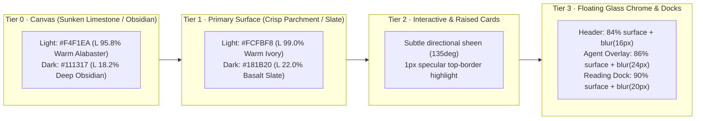

# 1st-assessment

> **Handoff Target:** Implementation Agents (Frontend / Design System / Vue 3 + Vuetify 3 + SCSS)  
> **Product Surface:** `tsEpistle` ("Tim O'Pedia" Governed Wiki + Inline Agent + Personal/Shared Memory System)  
> **Target Markets:** Education (Curriculum & Research), Sales (Revenue Enablement & Battlecards), and AI (Agentic Knowledge Operations)  
> **Assessment Mode:** Visual & Source Inspection Only — Evolutionary Refinement Prescription (Zero Application Code Mutated)

---

## 1. Executive Design Thesis: From "Sloppy-if-Pleasant" to *Luminous Archive, Elevated*

`tsEpistle` already possesses the bones of a distinctive 2026 enterprise identity: the pairing of editorial **Newsreader** display serifs with **Roboto Flex** UI sans and **JetBrains Mono** metadata, a warm amber-gold brand mark (`#F9A134`), an atmospheric 3D WebGL particle cloud on sign-in, and an ambitious governed-knowledge architecture uniting Wiki pages, a contextual AI Agent, Personal/Agent Memory, and an encrypted Offline Vault.

Yet in live browser inspection across **61 viewport/state captures**, the current frontend reads as **"sloppy-if-pleasant"**:

1. **Inverted & Muddy Material Physics:** The default *Luminous Archive* light palette sets `background` to warm alabaster (`#F7F7F5`, L≈97.0%) and `surface` to cool blue-slate white (`#F8F9FA`, L≈97.6%). Because the luminance delta is `< 0.6%` and the color temperature flips from warm yellow-red to cool blue-gray, cards and rails look washed-out and accidentally mismatched rather than carved from timeless mineral materials. Worse, `secondary` (`#484C51`) and `accent` (`#818385`) are dead neutral grays; mixing primary amber (`#F9A134`) with `#484C51` in sRGB (`--wiki-ambient-accent`) produces a murky olive-brown (`#B5803F`) that makes active nav pills, toggle switches, and header/footer gradient bars fade from bright orange into dirty charcoal.
2. **Broken Spatial & Scroll Mechanics:** On desktop (`1440×900`), the Reader crushes article prose into `~58%` of the viewport behind **two** left navigation columns (`260px` Browse Drawer + `280px` Page Tools/TOC Rail). Scrolling down a long article slices the sticky `.page-tools-card` in half under the header (`y = 52px`), cutting the 8 utility icons in two. On short pages, JS seam-alignment (`updateDesktopRailMeasurements()`) pushes `.page-tools-card` down by `~70px`, leaving a dead white hole beside the hero title. On mobile/tablet (`390×844`, `768×1024`), floating FABs (`.page-nav-toggle`, `.page-return-top`, `.page-reading-dock`) sit directly on top of article text, and stacked utility/TOC cards push prose below `y = 450px`.
3. **Systemic Focus & Chrome Clutter:** A global `:has(:focus-visible)` rule in `client/scss/base/base.scss` and `client/scss/components/v-form.scss` draws an outer `2px solid` rectangle + halo around `.v-field` **on top of** Vuetify's native `.v-field__outline`, slicing straight through floating notched labels (`Email Address`, `Find a section`, `Title`) across every form and modal in the app. Meanwhile, a global `4rem × 4rem` coordinate grid overlay (`app.scss:27-36`) adds visual static behind every table, card, and source view.
4. **High Time-to-Value Friction for Education, Sales, and AI Users:**
   - **Sales reps** opening Search (`Ctrl+K`) face `240px` of scope pills, filter bars, and disclaimers before seeing results that **omit matching text snippets** (`Matches page text · knowledge hints`), forcing a manual click on `[Preview]` for every single hit.
   - **Educators & students** entering Focus Reading mode trigger an orphaned `"Focus"` tooltip stranded at `(x=8, y=10)` over the brand logo, and opening `Choose a section` renders duplicate headers (`Choose a section` + `ON THIS PAGE 47`) inside a double-outlined filter box.
   - **AI operators** opening the contextual Wiki Agent face `36%` low-opacity glass that bleeds saturated orange/red/green blobs from underlying page badges straight through the welcome prompt and starter cards, while wide (`1800px`) screens artificially force `Conversations` (History) and `Memory` to be mutually exclusive in the same left column.

---

## 2. Material Language: Gradients, Transparencies & Timeless Mineral Surfaces

To communicate **influence and timeless materials** (warm parchment, honed limestone, smoked obsidian, and brushed amber-bronze) without visual noise, implementation agents must replace the flat sRGB gray-amber mixes with a **4-tier perceptual material hierarchy** and **calibrated OKLCH gradient/translucency tokens**.

### 2.1 Canonical Palette Refinement (`shared/theme-colors.ts` & `client/helpers/theme.ts`)

| Token | Current Light | Prescribed Light | Current Dark | Prescribed Dark | Material Rationale |
| :--- | :--- | :--- | :--- | :--- | :--- |
| `background` | `#F7F7F5` | **`#F4F1EA`** | `#181A1C` | **`#111317`** | Deepens Light canvas by ~1.5% warm parchment luminance so `#FCFBF8` cards pop cleanly without heavy drop shadows; deepens Dark canvas for true obsidian depth. |
| `surface` | `#F8F9FA` *(cool blue-gray)* | **`#FCFBF8`** *(warm ivory)* | `#212529` | **`#181B20`** | Eliminates the warm-background vs. cool-surface temperature clash; establishes a crisp `3.2%` luminance step above `background`. |
| `primary` | `#F9A134` | **`#E88D1F`** *(burnished amber)* | `#F9A134` | **`#F9A134`** | Tightens light-mode primary contrast from `1.96:1` while keeping warm gold energy; paired with `--wiki-primary-ink: #9A5406` for text/icons. |
| `secondary` | `#484C51` *(dead charcoal)* | **`#3B4D6B`** *(mineral indigo-slate)* | `#ADB5BD` | **`#8CA2C6`** | Replaces dead neutral gray with an authoritative scholarly/enterprise mineral slate-indigo so dual-tone gradients (`primary` → `secondary`) transition through warm bronze into deep slate rather than dirty brown. |
| `accent` | `#818385` *(mid gray)* | **`#8C6239`** *(brushed bronze)* | `#CED4DA` | **`#D4A373`** | Gives secondary badges, citations, and provenance borders a timeless metallic bronze tone instead of disabled-looking gray. |

### 2.2 Mixing & Matching Subtle Gradients & Transparencies (`client/scss/base/base.scss`)

Replace sRGB gray mixing in `client/scss/base/base.scss` (lines 17–82) with perceptual `in oklch` blends and layered surface translucencies:

1. **Directional Mineral Card Sheen (`--wiki-surface-gradient`):**
   - **Light:** `linear-gradient(145deg, color-mix(in oklch, var(--wiki-surface-raised) 96%, var(--wiki-accent-warm) 4%) 0%, var(--wiki-surface-raised) 62%, color-mix(in oklch, var(--wiki-surface-raised) 97%, var(--wiki-accent-spectral) 3%) 100%)`
   - **Dark:** `linear-gradient(145deg, color-mix(in oklch, var(--wiki-surface-raised) 94%, var(--wiki-accent-warm) 6%) 0%, var(--wiki-surface-raised) 58%, color-mix(in oklch, var(--wiki-surface-raised) 95%, var(--wiki-accent-spectral) 5%) 100%)`
2. **Specular Top-Edge Hairline (`--wiki-specular-border`):**
   - Apply `box-shadow: inset 0 1px 0 0 rgba(255, 255, 255, 0.65)` (Light) / `inset 0 1px 0 0 rgba(255, 255, 255, 0.07)` (Dark) on raised cards (`.page-tools-card`, `.page-toc-card`, `.admin-stat`, `.dashboard-connection`, `.inline-agent__starter-card`) to evoke machined architectural glass and archival card stock.
3. **Three Calibrated Translucency Tiers:**
   - **Tier A — Persistent Chrome (`--wiki-chrome-surface`):** `color-mix(in oklch, rgb(var(--v-theme-surface)) 84%, transparent)` with `backdrop-filter: blur(16px) saturate(140%)`.
   - **Tier B — Floating HUDs & Reading Dock (`--wiki-hud-surface`):** `color-mix(in oklch, rgb(var(--v-theme-surface)) 90%, transparent)` with `backdrop-filter: blur(20px) saturate(150%)` and a `1px solid color-mix(in oklch, var(--wiki-accent-warm) 24%, var(--wiki-surface-border))` border.
   - **Tier C — Contextual Agent Stage (`.inline-agent--contextual .inline-agent__body`):** Raise from the current `36%` opacity (`blur(10px)`) to **`86%` opacity (`blur(24px) saturate(125%)`)** in Light mode and **`84%` opacity (`blur(26px) saturate(130%)`)** in Dark mode. This preserves a whisper of warm/cool page influence from the underlying wiki article while guaranteeing WCAG AA/AAA text legibility across the Agent conversation.

---

## 3. Purposeful Enterprise Gamification & Joy Architecture

Enterprise gamification in `tsEpistle` must **never** resort to juvenile leaderboards, cartoon confetti, or arbitrary points. Grounded in **Self-Determination Theory** (*Competence*, *Autonomy*, and *Relatedness*), every micro-reward must accelerate real work for **Education**, **Sales**, and **AI** professionals:

| Market | Feature Prescription | Trigger & Mechanics | Visual & Material Expression | Why It Adds Joy Without Distraction |
| :--- | :--- | :--- | :--- | :--- |
| **Education** *(Competence)* | **1. Section Mastery & Reading Progress Spine** | As a reader scrolls through sections or completes `
` disclosures, the active bar in `ON THIS PAGE` (`.page-toc-card`) and the Focus Mode `.page-reading-dock` fills a subtle `2px` burnished-amber progress spine and marks completed sections with a muted bronze check dot. | Uses `--wiki-accent-warm` → `--wiki-accent-spectral` gradient fill along the left TOC rail; persists per-page in `localStorage` (`wiki:reading-mastery:<pageId>`). | Turns daunting 47-section reference pages (like `Homepage` or curriculum guides) into structured, conquerable learning modules. |
| **Education** *(Competence & Autonomy)* | **2. Inline Glossary Hover-Cards & "Got It" Recall Pin** | Hovering or focusing a defined Glossary term in article prose opens a translucent Tier-B mineral hover-card (`280px`) with the definition, locale badge, and a 1-click `Pin to my memory` action. | Frosted parchment card (`90%` surface + `blur(20px)`) with a 1px bronze top specular border. | Eliminates context-switching into the `Ctrl+K` Glossary tab while rewarding active vocabulary building. |
| **Sales** *(Time Utility & Competence)* | **3. Battlecard Rapid-Copy Receipt & Attractor Sweep** | In Search Overlay (`Ctrl+K`), Disclosure summaries (`Increases, Tariffs & Surcharges`), and Pricing callouts, hovering reveals a `Copy snippet` (`⌘C`) pill. Clicking copies clean formatted text + source citation link and triggers a `450ms` `--wiki-attractor-sweep` shimmer across the row with a `"Copied with citation"` pill. | Uses existing `@keyframes wiki-border-beam` / `--wiki-attractor-sweep` (`animation.scss`) constrained to a single `450ms` pass. | Sales reps answering live prospect or pricing questions get instant, cited battlecard snippets in `< 2 seconds` instead of opening full pages. |
| **Sales & Education** *(Relatedness & Trust)* | **4. Living Stewardship & Freshness Pulse** | Replace the static `"Updated 10/16/2026 by Administrator"` block in `.page-tools-card` with a **Stewardship Trust Pill**: Verified Fresh (`< 30 days`, emerald-mineral dot), Review Soon (`30–90 days`, amber dot), or Needs Verification (`> 90 days`), plus a 1-click `✓ Verify accuracy` micro-attestation for authorized editors. | Subtle tonal pill with `1px` specular border in the unified Page Hero metadata bar. | Communicates immediate citation authority to sales reps and educators while lightly gamifying page upkeep for workspace stewards. |
| **AI** *(Autonomy & Competence)* | **5. Memory Crystal Chips & Context Coverage Ring** | In the Wiki Agent composer (`agent-composer.vue`) and header (`inline-agent-chat.vue`), display an interactive **Context Coverage Ring** (`svg` 18px circular meter showing active pages/sources `/ 8` + active `You`/`Agent` memory crystals). When the Agent recalls or saves a memory, pulse a single `600ms` spectral border beam around the `Memory` pill. | Translucent amber (`You`) and mineral-indigo (`Agent`) micro-chips with a smooth stroke-dashoffset SVG ring. | Makes invisible RAG/Memory mechanics tangible and trustworthy, rewarding users for curating high-signal context and personal memories. |

---

## 4. Prioritized Findings & Actionable Prescriptions (`P0` → `P1` → `P2`)

Every finding below is grounded in live browser captures (`01`–`61`) and verified against exact source lines. Implementation agents should execute **`P0`** first (broken layout, clipping, contrast loss, and systemic focus bugs), followed by **`P1`** (information hierarchy, time-utility, and material harmony), and **`P2`** (fine craft, responsive polish, and enterprise-gamification micro-interactions).

---

### P0 — Critical Usability, Layout Clipping & Systemic Visual Defects

#### P0-01: Global Double Focus Ring Slices Through Outlined Input Labels Across All Surfaces
- **Page / Component:**
  - [base.scss](file:///home/bbferko/repos/tsEpistle/client/scss/base/base.scss#L230-L246)
  - [v-form.scss](file:///home/bbferko/repos/tsEpistle/client/scss/components/v-form.scss#L121-L133)
- **Observed Problem:**
  - Visually confirmed in `01-login-desktop-light.png`, `02-login-desktop-dark.png`, `16-reader-focus-sections-open.png` (`Find a section`), `24-search-overlay-empty.png`, `35-agent-sources-picker.png` (`Search pages`), and `44-editor-page-properties.png` (`Title`).
  - `base.scss:233` (`:where(.v-field):has(:focus-visible)`) and `v-form.scss:127` (`.v-input .v-field:has(input:focus-visible, textarea:focus-visible, select:focus-visible)`) apply `outline: 2px solid var(--wiki-focus-color); outline-offset: 2px; box-shadow: var(--wiki-focus-ring)` to the outer `.v-field` wrapper **while** Vuetify simultaneously renders its notched `.v-field__outline` border. The outer `outline` draws a second concentric rectangle that slices horizontally straight through floating `<label class="v-field-label--floating">` text (`Email Address`, `Title`).
- **User Impact:**
  - Every focused text input across Login, Reader, Search, Agent, Editor, Profile, and Admin looks visually broken and clips floating field labels in half.
- **Specific Correction:**
  1. In [base.scss](file:///home/bbferko/repos/tsEpistle/client/scss/base/base.scss#L230-L237), remove `.v-field` from the `outline: 2px solid var(--wiki-focus-color)` rule.
  2. In [v-form.scss](file:///home/bbferko/repos/tsEpistle/client/scss/components/v-form.scss#L121-L133), style focus on Vuetify fields by coloring the existing `.v-field__outline` (`--v-field-border-opacity: 1;--v-field-border-width: 2px; color: var(--wiki-focus-color)`) and applying `box-shadow: 0 0 0 3px color-mix(in oklch, var(--wiki-focus-color) 18%, transparent)` on `.v-field--focused` with `outline: none`, preserving the notched floating label cutout.
- **Acceptance Criteria:**
  - Focusing any `variant="outlined"` or `variant="solo"` `v-text-field`, `v-select`, `v-autocomplete`, or `v-combobox` renders a single crisp `2px` border (with notched label intact) plus a soft outer halo, with `getComputedStyle(field).outlineStyle === 'none'`.

---

#### P0-02: Sticky Desktop Reader Rail (`#page-desktop-rail`) Clips `.page-tools-card` Under Header on Scroll
- **Page / Component:**
  - [page.vue](file:///home/bbferko/repos/tsEpistle/client/themes/default/components/page.vue#L5250-L5326)
  - [page.vue](file:///home/bbferko/repos/tsEpistle/client/themes/default/components/page.vue#L4454-L4485)
- **Observed Problem:**
  - Visually confirmed in `13-reader-bottom-ratings-footer.png`: when scrolled down `/en/home`, `#page-desktop-rail` is `position: sticky; top: calc(var(--v-layout-top, 64px) + 16px)`, **but** it also retains a negative `margin-block-start: calc((var(--page-toc-desktop-lift) * -1) + var(--page-desktop-rail-align-offset, 0px))` (`page.vue:5259`).
  - Conversely, on short pages (`20-reader-secondary-page.png`, `/en/contract-interiors-tribute`), `updateDesktopRailMeasurements()` (`page.vue:4454-4479`) computes a positive `--page-desktop-rail-align-offset` to align the bottom seam of `.page-tools-card` with `.page-hero`, pushing `.page-tools-card` down by `~70px` and leaving an awkward empty void at the top-left of the hero.
  - During scroll on long pages, the negative margin pulls the top half of `.page-tools-card` (`Share`, `Subscribe`, `Focus`, `Width`, `Print`, `Offline`, `Source`, `History`) underneath `.nav-header` (`y = 52px`), slicing all 8 utility icons in half horizontally.
- **User Impact:**
  - Core page actions (`Focus`, `Save offline`, `History`) are physically cut in half and unclickable/illegible while scrolling long educational or sales directory pages, and short pages have a visibly lopsided top-left gap.
- **Specific Correction:**
  1. Remove the negative `margin-block-start` and dynamic bottom-seam offset (`--page-desktop-rail-align-offset`) from `#page-desktop-rail` in [page.vue](file:///home/bbferko/repos/tsEpistle/client/themes/default/components/page.vue#L4454-L4485) and [page.vue](file:///home/bbferko/repos/tsEpistle/client/themes/default/components/page.vue#L5255-L5264).
  2. Align the top of `#page-desktop-rail` flush with the top of `.page-hero` (`margin-block-start: 0; top: calc(var(--v-layout-top, 56px) + var(--wiki-space-4))`) and set `max-height: calc(100dvh - var(--v-layout-top, 56px) - var(--wiki-space-8))` so the rail never clips under `.nav-header` at any scroll position.
- **Acceptance Criteria:**
  - At `scrollY = 0` on both `/en/home` and `/en/contract-interiors-tribute`, `#page-desktop-rail` top-aligns within `4px` of `.page-hero` (`getBoundingClientRect().top` delta `<= 4px`).
  - At `scrollY = 1500` on `/en/home`, `.page-tools-card`'s `getBoundingClientRect().top` is `>= 68px` (completely clear of `.nav-header` bottom at `56px`).

---

#### P0-03: Default "Luminous Archive" Light Palette Temperature Inversion & Dead Charcoal Secondary/Accent Tokens
- **Page / Component:**
  - [theme-colors.ts](file:///home/bbferko/repos/tsEpistle/shared/theme-colors.ts#L16-L38)
  - [theme.ts](file:///home/bbferko/repos/tsEpistle/client/helpers/theme.ts#L140-L245)
  - [base.scss](file:///home/bbferko/repos/tsEpistle/client/scss/base/base.scss#L17-L76)
- **Observed Problem:**
  - Visually confirmed across `05-reader-desktop-light.png`, `44-editor-page-properties.png`, and `54-admin-theme-palettes.png`.
  - In `shared/theme-colors.ts:17-21`, `DEFAULT_THEME_COLORS.light` defines `background: '#F7F7F5'` (warm yellow-tinted alabaster) and `surface: '#F8F9FA'` (cool blue-gray Bootstrap slate). In `54-admin-theme-palettes.png`, the first two swatches of `Luminous Archive` are visually indistinguishable (`< 0.6%` luminance difference), causing cards to vanish into the page background.
  - `light.secondary` is `#484C51` (charcoal gray) and `light.accent` is `#818385` (mid gray). Because `base.scss:20-21` sets `--wiki-accent-spectral: rgb(var(--v-theme-secondary))` and `--wiki-ambient-accent: color-mix(in srgb, rgb(var(--v-theme-primary)) 62%, rgb(var(--v-theme-secondary)) 38%)`, every gradient and active state mixes orange `#F9A134` with charcoal `#484C51` in sRGB to produce a muddy olive-brown (`#B5803F`). This makes active switches (`Published` in `44-editor-page-properties.png`), `.nav-sidebar-switcher` (`05`), `.nav-footer` (`13`), and the 404 top bar (`20-reader-secondary-page-ratings-tags.png`) look dingy or disabled.
- **User Impact:**
  - Undermines brand authority across every light-mode screen; cards lack depth separation from the canvas, and active controls appear muddy brown.
- **Specific Correction:**
  1. Update `DEFAULT_THEME_COLORS` in [theme-colors.ts](file:///home/bbferko/repos/tsEpistle/shared/theme-colors.ts#L16-L38) to the calibrated mineral values in Section 2.1 (`light.background: '#F4F1EA'`, `light.surface: '#FCFBF8'`, `light.primary: '#E88D1F'`, `light.secondary: '#3B4D6B'`, `light.accent: '#8C6239'`; `dark.background: '#111317'`, `dark.surface: '#181B20'`, `dark.secondary: '#8CA2C6'`, `dark.accent: '#D4A373'`).
  2. Change all `color-mix(in srgb, ...)` calls involving `--wiki-accent-warm`, `--wiki-accent-spectral`, and `--wiki-ambient-accent` in [base.scss](file:///home/bbferko/repos/tsEpistle/client/scss/base/base.scss#L17-L76) to `color-mix(in oklch, ...)` so warm-to-cool mineral transitions maintain chroma without dipping through gray mud.
- **Acceptance Criteria:**
  - Light-mode relative luminance delta between `background` (`#F4F1EA`) and `surface` (`#FCFBF8`) is `>= 3.0%`, with both sharing a warm hue angle (`60°–85°` in OKLCH).
  - Active `v-switch` and `.v-list-item--active` states render a clean warm-amber tint rather than `#B5803F` olive-brown.

---

#### P0-04: Contextual Wiki Agent Glass (`36%` Opacity) Bleeds Saturated Underlying Page Colors Behind Conversation & Composer
- **Page / Component:**
  - [inline-agent-chat.vue](file:///home/bbferko/repos/tsEpistle/client/components/agents/inline-agent-chat.vue#L2302-L2335)
- **Observed Problem:**
  - Visually confirmed in `31-agent-workspace-1440-light.png` and `32-agent-workspace-1800-3panel-light.png`.
  - When opening the Wiki Agent from a page (`contextual === true`), `.inline-agent--contextual .inline-agent__body` (`inline-agent-chat.vue:2318-2321`) uses `--inline-agent-contextual-glass: color-mix(in srgb, rgb(var(--v-theme-surface)) 36%, transparent)` with `backdrop-filter: blur(10px) saturate(150%)`.
  - Because `saturate(150%)` boosts underlying emoji, links, and callouts while `36%` surface opacity lets `64%` of the underlying page show through, bright orange, red, and green blobs from `Homepage` bleed directly behind `"Ask about Homepage"`, the 3 starter prompt cards, and the bottom composer.
- **User Impact:**
  - Severely degrades reading contrast and visual calm in the primary AI workspace; looks like an unstyled CSS z-index leak rather than intentional glassmorphism.
- **Specific Correction:**
  1. In [inline-agent-chat.vue](file:///home/bbferko/repos/tsEpistle/client/components/agents/inline-agent-chat.vue#L2303-L2325), increase `--inline-agent-contextual-glass` in light mode from `36%` to **`86%`** (`color-mix(in oklch, rgb(var(--v-theme-surface)) 86%, transparent)`) and in dark mode from `42%` to **`84%`**.
  2. Increase `--inline-agent-contextual-blur` from `blur(10px) saturate(150%)` to **`blur(24px) saturate(125%)`** so underlying page colors diffuse into a subtle, soft ambient aura rather than recognizable blotches.
  3. Give `.inline-agent__starter-card` and `.agent-composer__surface` a `94%` raised surface fill with `--wiki-specular-border`.
- **Acceptance Criteria:**
  - Opening the contextual Agent over `/en/home` yields a smooth ambient mineral glass surface with `>= 7:1` text contrast on `.inline-agent__empty-title` and zero legible bleed-through of underlying article links or emoji.

---

#### P0-05: Focus Reading Mode Strands Orphaned `"Focus"` Tooltip at `(0, 0)` and Overlaps Article Prose with Low-Contrast Dock
- **Page / Component:**
  - [page.vue](file:///home/bbferko/repos/tsEpistle/client/themes/default/components/page.vue#L345-L361)
  - [page.vue](file:///home/bbferko/repos/tsEpistle/client/themes/default/components/page.vue#L432-L446)
  - [page.vue](file:///home/bbferko/repos/tsEpistle/client/themes/default/components/page.vue#L6614-L6755)
- **Observed Problem:**
  - Visually confirmed in `15-reader-focus-dock.png` and `16-reader-focus-sections-open.png`.
  - Clicking `.page-focus-control` sets `readerFocus = true`, which immediately hides `#page-desktop-rail` while the button's `v-tooltip` is still mounted/active, stranding a floating black `"Focus"` tooltip at the top-left corner `(x = 8, y = 10)` directly over the `Tim O'Pedia` logo (`15-reader-focus-dock.png`).
  - At the bottom-right, `.page-reading-dock` floats directly over black article text (`"• 11.4.25..."`) with insufficient backdrop separation, and opening `Choose a section` (`16-reader-focus-sections-open.png`) renders **duplicate headers** inside the popover (`Choose a section [X]` AND `ON THIS PAGE 47`).
- **User Impact:**
  - Focus Reading mode—meant to be the calmest surface for Education and research users—introduces a stuck tooltip bug at the top-left and visual collisions at the bottom-right.
- **Specific Correction:**
  1. In [page.vue](file:///home/bbferko/repos/tsEpistle/client/themes/default/components/page.vue#L345-L361), explicitly close/unmount the tooltip (`:model-value="false"` when `readerFocus` is true or blur the trigger before toggling `readerFocus`) so no orphaned `.v-overlay__content` remains at `(0, 0)`.
  2. When `.page-toc-card` is rendered inside `.page-reading-dock__sheet` (`readerFocus === true`), hide the inner `.page-toc-header` (`ON THIS PAGE 47`) or merge the count badge (`47`) into `.page-reading-dock__sheet-bar` (`Choose a section · 47 [✕]`).
  3. Add bottom padding (`padding-bottom: 5.5rem`) to `.page-body-column` when `readerFocus` is active, and style `.page-reading-dock` with Tier-B glass (`92%` surface + `blur(20px)` + `var(--wiki-shadow-md)`).
- **Acceptance Criteria:**
  - Toggling Focus mode via mouse click leaves zero `.v-tooltip` overlays visible after `200ms`.
  - Opening `Choose a section` in Focus mode shows a single header bar (`Choose a section · 47`) and a single clean focus border on `Find a section`.

---

#### P0-06: Mobile & Tablet Floating Action Buttons (`.page-nav-toggle`, `.page-return-top`) Collide with Article Text and Disclosures
- **Page / Component:**
  - [page.vue](file:///home/bbferko/repos/tsEpistle/client/themes/default/components/page.vue#L4778-L4795)
  - [page.vue](file:///home/bbferko/repos/tsEpistle/client/themes/default/components/page.vue#L6140-L6324)
- **Observed Problem:**
  - Visually confirmed in `11-reader-tablet-light.png` (`768×1024`), `12-reader-mobile-light.png` (`390×844`), and `21-reader-secondary-page-bottom.png` (`1440×900`).
  - On Tablet and Mobile (`< 960px`), `.page-nav-toggle` renders a floating `48×48px` orange-brown hamburger FAB at the bottom-left (`bottom: 16px; left: 16px`) directly on top of article disclosure rows (`> Supply Disruptions`), **even though** `.nav-header` at the top-left (`y = 8px, x = 12px`) **already has a hamburger menu button**!
  - At the bottom-right, `.page-return-top` (`21-reader-secondary-page-bottom.png`) floats directly over the last line of article prose (`"turn commer..."`).
- **User Impact:**
  - Obscures readable content and interactive `
` summaries on mobile, tablet, and desktop viewports, and confuses mobile users with two competing hamburger buttons on the same screen.
- **Specific Correction:**
  1. Remove the redundant bottom-left `.page-nav-toggle` FAB (`page.vue:6140-6225`) on `< 960px` viewports; the top-left `.nav-header` drawer button is the single canonical navigation trigger on mobile/tablet.
  2. Reposition `.page-return-top` so it docks inside the right page margin (`inset-inline-end: max(1rem, calc((100vw - var(--wiki-shell-max)) / 2 + 1rem))`) on desktop, or integrate `"Top ↑"` into the compact sticky reading progress bar on mobile so it never overlaps `.contents` prose.
- **Acceptance Criteria:**
  - On `390×844` and `768×1024`, only one navigation drawer toggle button exists (in `.nav-header`), and zero floating buttons intersect `.contents p` or `.contents details` bounding boxes.

---

#### P0-07: Dark-Mode Login Particle Cloud Loses the `"T"` Letterform Against Dark Background
- **Page / Component:**
  - [particle-colors.ts](file:///home/bbferko/repos/tsEpistle/client/components/login/particle-colors.ts)
  - [login.vue](file:///home/bbferko/repos/tsEpistle/client/components/login.vue)
- **Observed Problem:**
  - Visually confirmed in `02-login-desktop-dark.png` vs. `01-login-desktop-light.png`.
  - The workspace logo (`Tim O'Pedia`) consists of a dark charcoal `"T"` (`#484C51`) and an amber `"O"` (`#F9A134`). In `particle-colors.ts`, source sRGB pixel colors are sampled directly without dark-mode luminance inversion/Floor clamping. Against the dark sign-in stage (`#181A1C`), the dark charcoal particles of the `"T"` vanish almost completely, leaving only a floating orange `"O"` hook.
  - Additionally, on desktop (`01`, `02`), the right-hand particle stage renders a faint rounded-rectangle border that neither bleeds edge-to-edge nor aligns with the left login card, and the login card repeats the small `40px` `TO` logo right next to the `600px` `TO` particle cloud. On mobile (`03-login-mobile-light.png`, `04-login-mobile-dark.png`), the particle cloud is completely hidden (`display: none`), leaving the bottom `55%` (`~460px`) of the `390×844` viewport completely blank.
- **User Impact:**
  - The signature 3D brand moment is half-invisible in dark mode and completely absent on mobile.
- **Specific Correction:**
  1. In `particle-colors.ts`, when rendering on a dark surface (`isDark === true`), lift low-luminance non-background particles (`L < 0.28`) into a warm silver-slate range (`L >= 0.72`, e.g., `#C8D0DC`) so the `"T"` stem reads with crisp mineral contrast alongside the `#F9A134` `"O"`.
  2. Remove the visible box border around the right-hand particle canvas so the particle cloud floats seamlessly in the ambient radial stage.
  3. On mobile (`< 960px`), render a lightweight ambient header/backdrop version of the particle canvas (`height: 220px`) or center the login card vertically (`min-height: calc(100dvh - 5rem); align-content: center`) so the bottom half of the screen is not a dead void.
- **Acceptance Criteria:**
  - In dark mode on `/login`, particles belonging to the `"T"` glyph have a minimum contrast ratio of `4.5:1` against `#111317`.
  - On `390×844`, the login card is vertically balanced with `< 160px` of trailing empty space below the card.

---

#### P0-08: Agent Administration (`/a/agents`) Clips 5 of 10 Section Tabs Off-Screen at `1440px` With No Scroll Affordance
- **Page / Component:**
  - [agent-admin.vue](file:///home/bbferko/repos/tsEpistle/client/components/agents/agent-admin.vue#L38-L60)
- **Observed Problem:**
  - Visually confirmed in `56-admin-agents.png`.
  - `.agent-sections` renders 10 large horizontal tab cards (`Overview`, `Generative models`, `Media providers`, `Agent Decision Providers`, `Model tasks & routing`, `Skills`, `Wiki tools & incoming MCP`, `External MCP`, `Knowledge & memory`, `Runtime policy`), each with an icon box, bold title, and multi-word subtitle.
  - At `1440×900` (with the `256px` Admin sidebar open), only `4.5` tabs fit across the `1120px` container. The 5th tab (`Model tasks & routing`) is sliced in half at the right edge, and the remaining **5 tabs** (`Skills`, `Wiki tools`, `External MCP`, `Memory`, `Runtime policy`) are completely hidden off-screen with **no scroll arrows, no gradient edge mask, and no visible scrollbar**.
- **User Impact:**
  - Administrators cannot discover or reach half of the AI control center (`Skills`, `MCP`, `Memory`, `Runtime policy`) without guessing that the tab strip scrolls horizontally or clicking inline links.
- **Specific Correction:**
  1. In [agent-admin.vue](file:///home/bbferko/repos/tsEpistle/client/components/agents/agent-admin.vue#L38-L60), compact `.agent-section` tabs by removing the verbose 2nd-line `<small>{{ section.description }}</small>` from the tab buttons (move the description into the active panel's header) and grouping the 10 sections into a clean wrap-capable 2-row pill bar or a compact 5-group segmented navigation bar (`Overview | Models & Routing | Skills & Tools | External MCP | Memory & Runtime`).
- **Acceptance Criteria:**
  - At `1440×900` on `/a/agents`, 100% of top-level Agent Administration navigation tabs are visible and clickable without horizontal scrolling or text clipping.

---

### P1 — Visual Harmony, Information Hierarchy & Time-Utility Prescriptions

#### P1-01: Reader Three-Column Squeeze, Cryptic 8-Icon Utility Box & Duplicate Hero Branding/Titles
- **Page / Component:**
  - [page.vue](file:///home/bbferko/repos/tsEpistle/client/themes/default/components/page.vue#L25-L88)
  - [page.vue](file:///home/bbferko/repos/tsEpistle/client/themes/default/components/page.vue#L305-L460)
  - [page-branding.ts](file:///home/bbferko/repos/tsEpistle/client/helpers/page-branding.ts#L43-L51)
- **Observed Problem:**
  - Visually confirmed in `05-reader-desktop-light.png`, `11-reader-tablet-light.png`, `12-reader-mobile-light.png`, and `20-reader-secondary-page.png`.
  - **Three-Column Squeeze:** At `1440px`, keeping the left `.nav-sidebar` (`260px`) AND `#page-desktop-rail` (`280px`) side-by-side on the left consumes `540px` (`37.5%` of the viewport) before a single word of article prose begins.
  - **Cryptic 8-Icon Utility Grid:** `.page-tools-card__utilities` (`page.vue:305-446`) crams 8 unlabeled icons (`Share`, `Watch`, `Focus`, `Full width`, `Print`, `Save offline`, `View source`, `History`) into a single row (`05`), duplicating `View Source` and `History` which are already in the header `...` menu (`40-header-page-actions-menu.png`).
  - **Tablet & Mobile Vertical Push (`11`, `12`):** Below `960px`, `.page-tools-card` and `.page-toc-card` stack full-width above the article, pushing the first line of article content down below `y = 450px` (`> 50%` of the viewport height).
  - **Duplicate Hero Logo & Duplicate `<h1>` (`05`, `20`):** On `/en/home` (`05`), `brandingDuplicatesSiteLogo()` (`page-branding.ts:43-51`) only checks exact path equality (`comparablePath(branding.imageUrl) === comparablePath(site.logoUrl)`), failing when the same workspace logo is uploaded as a page branding asset and rendering a giant `128px` `TO` logo in `.page-hero` right below the header `TO` logo. On `/en/contract-interiors-tribute` (`20`), the page title `"A Tribute to Contract Interiors"` renders in `.page-hero`, again as `<h1>` `32px` below the hero border, and a third time in `ON THIS PAGE`.
- **User Impact:**
  - Wastes horizontal real estate on desktop, buries content below the fold on mobile/tablet, and forces users to hover 8 mystery icons to find basic reading actions.
- **Specific Correction:**
  1. **Retire the standalone `.page-tools-card` box:** Move `Last updated · Author` + the new **Stewardship Trust Pill** directly into `.page-hero`'s metadata row (`KNOWLEDGE / EN · Updated Oct 16, 2026 by Administrator · Verified`).
  2. **Consolidate Reader Utilities:** Keep only 3 high-frequency reader actions as labeled/clear pills in the hero corner (`Focus`, `Save offline`, `Share`); leave `Print`, `Full width`, `View Source`, and `History` in the header's `...` Page Actions menu (with a `<v-divider>` separating read actions from `Convert / Duplicate / Move` and destructive `Delete` in `nav-header.vue`).
  3. **Collapsible TOC Drawer on `< 1280px` & Right-Rail Default:** Move `ON THIS PAGE` (`.page-toc-card`) to a slim `220px` right-hand rail on wide viewports (`>= 1280px`), and on Tablet/Mobile (`< 1280px`) collapse `ON THIS PAGE (47)` into a single `40px` sticky summary bar at the top of the article instead of an expanded `280px` box above the prose.
  4. **Deduplicate Hero `<h1>` and Site Logo:** Strip or visually hide a leading markdown `# Title` when it matches `page.title` normalized (`page.vue`), and compare asset content hash or normalized filename in `brandingDuplicatesSiteLogo()` (`page-branding.ts:43-51`).
- **Acceptance Criteria:**
  - On `1440×900`, the article prose column begins at `x <= 300px` (when left nav is open) and has a clean `220px` right-hand `ON THIS PAGE` rail.
  - On `390×844` and `768×1024`, the first paragraph/heading of `.contents` begins above `y = 260px`.
  - `/en/contract-interiors-tribute` displays `"A Tribute to Contract Interiors"` once in `.page-hero`, not twice in the main column.

---

#### P1-02: Search Overlay (`Ctrl+K`) Chrome Overhead, Missing Inline Match Snippets & Raw Glossary/Offline States
- **Page / Component:**
  - [search-results.vue](file:///home/bbferko/repos/tsEpistle/client/components/common/search-results.vue#L1-L460)
- **Observed Problem:**
  - Visually confirmed in `24-search-overlay-empty.png`, `25-search-overlay-results.png`, `26-search-source-preview.png`, `27-search-offline-scope.png`, and `28-search-glossary-scope.png`.
  - **240px Chrome Overhead & Zero Inline Snippets (`25`):** Searching `"contract"` renders 3 stacked control bars (`All results | Saved offline | Glossary`, ` Filter by tag | Current section (/en) | Only titles`, and `"Ask prepares a draft. Nothing is sent."`) consuming `240px` of vertical height before the first hit. Each result row shows only the title, path (`EN /home`), and generic boilerplate `"Matches page text · knowledge hints"`—**hiding the actual matching sentence** until the user clicks `[Preview]`!
  - **Stripped Source Preview (`26`):** Clicking `[Preview]` opens `SOURCE NOTEBOOK`, which strips markdown formatting/tables into flat plain-text paragraphs with double line breaks.
  - **Apology UI in `Saved offline` (`27`):** Switching to `Saved offline` renders a disabled `[Preview]` button on every row plus a prominent apology note: `"Preview is available for online wiki results, not downloaded pages."`
  - **Raw Admin Controls & 0-Result Pagination in `Glossary` (`28`):** Switching to `Glossary` inside the reader's `Ctrl+K` overlay exposes raw management controls (`Catalog locale [en]`, `[Change locale]`, `[+ New term]`) and renders `[Previous] Page 1 of 1 [Next]` even when `0 matching terms` are found!
- **User Impact:**
  - Sales and support reps searching under time pressure cannot scan pricing/contract numbers inline in search results and must click `[Preview]` row-by-row.
- **Specific Correction:**
  1. **Render 2-Line Highlighted Match Snippets Inline:** In `search-results.vue`, display the matching excerpt (`item.snippet` or highlighted context window around the query term) directly inside each `.search-results-item` with `<mark>` amber highlighting, plus a hover `Copy snippet` action (Section 3, Gamification #3).
  2. **Compact Search Filter Bar into Single Row:** Merge Scope (`All | Offline | Glossary`) and Filters (`Tag ▾`, `In /en`, `Titles only`) onto a single `40px` toolbar row; move `"Ask prepares a draft..."` into the tooltip of `[Ask with 2 sources]`.
  3. **Hide `[Preview]` in Offline Scope & Hide Pagination on `0` Glossary Results:** In `Saved offline` scope (`27`), omit the `[Preview]` button and apology banner entirely (clicking the row opens the offline page directly). In `Glossary` scope (`28`), hide pagination when `total <= pageSize`, auto-apply `Catalog locale` on `@update:model-value` (removing the manual `[Change locale]` button), and move `[+ New term]` to a subtle footer link for authorized editors.
- **Acceptance Criteria:**
  - Searching `"contract"` in `Ctrl+K` shows the first result above `y = 165px`, and each result row displays up to 2 lines of matching text with highlighted query terms.
  - `Saved offline` results show zero disabled `[Preview]` buttons, and an empty `Glossary` search shows zero pagination buttons.

---

#### P1-03: Wiki Agent Wide-Viewport Panel Exclusivity, `"Createv"` Spacing & 1-Item Overflow Menu
- **Page / Component:**
  - [inline-agent-chat.vue](file:///home/bbferko/repos/tsEpistle/client/components/agents/inline-agent-chat.vue#L1439-L1460)
  - [inline-agent-chat.vue](file:///home/bbferko/repos/tsEpistle/client/components/agents/inline-agent-chat.vue#L2380-L2460)
  - [agent-composer.vue](file:///home/bbferko/repos/tsEpistle/client/components/agents/agent-composer.vue#L248-L350)
- **Observed Problem:**
  - Visually confirmed in `31-agent-workspace-1440-light.png`, `32-agent-workspace-1800-3panel-light.png`, `34-agent-history-panel.png`, `35-agent-sources-picker.png`, `37-agent-composer-skills-menu.png`, and `39-agent-mobile-history-modal.png`.
  - **Mutually Exclusive Side Panels on Wide Viewports (`32`):** Even at `1800×1000` (`panelMode === 'wide'`), `toggleHistory()` (`inline-agent-chat.vue:1443`) forces `memoryOpen.value = false`, and `toggleMemory()` (`1456`) forces `historyOpen.value = false`. Both panels mount into the exact same left column instead of allowing a true 3-column workbench (`Conversations` on left, `Chat` in center, `Memory` on right) on `>= 1600px` screens.
  - **`"Createv"` Missing Icon Gap & 1-Item Overflow Menu (`31`, `37`):** In `agent-composer.vue`, the `[✨ Createv]` button has zero margin between `"Create"` and its append chevron (`mdi-chevron-down`), reading as `"Createv"`. Immediately to its right, despite `> 400px` of empty horizontal space in the composer bar on desktop, a `...` button opens a 1-item menu containing only `🧩 Skills >` (`37-agent-composer-skills-menu.png`).
  - **Double-Border Empty Card in `Conversations` (`34`) & Stacked Mobile Modal Header (`39`):** In `34-agent-history-panel.png`, `"No recent conversations outside folders"` renders a dashed border nested inside an outer solid border whose bottom corners protrude. On mobile (`39-agent-mobile-history-modal.png`), opening `Conversations` stacks `[🧠 Memory]` as an extra full-width header row above `🕒 Conversations [X]`.
  - **Add Sources Dialog (`35`):** Uses an unlabeled `✓` icon button next to `✕` in the dialog header and shows an empty box (`"Enter at least two characters to search pages."`) instead of pre-populating recent/current-section pages.
- **User Impact:**
  - AI power users on desktop monitors cannot view conversation history and active memories simultaneously; composer tools (`Skills`) require an unnecessary extra click; and the Add Sources modal forces typing before showing any pages.
- **Specific Correction:**
  1. **True 3-Column Wide Layout (`>= 1600px`):** In [inline-agent-chat.vue](file:///home/bbferko/repos/tsEpistle/client/components/agents/inline-agent-chat.vue#L1439-L1460), when `panelMode === 'wide'`, allow `historyOpen` (left rail, `280px`) and `memoryOpen` (right rail, `300px`) to remain open simultaneously around the center conversation column.
  2. **Promote `Skills` to a Top-Level Composer Pill & Fix `"Create"` Chevron Gap:** In [agent-composer.vue](file:///home/bbferko/repos/tsEpistle/client/components/agents/agent-composer.vue#L248-L350), render `[🧩 Skills ▾]` directly beside `[+ Sources]` and `[✨ Create ▾]` on viewports `>= 600px`, eliminating the 1-item `...` menu on desktop, and add `margin-inline-start: 4px` to the append chevron of `Create`.
  3. **Pre-populate Add Sources Dialog & Label Confirm Button:** In `35-agent-sources-picker.png`, replace the top-right unlabeled `✓` icon with a primary footer/header button `Apply (N)` and pre-populate the list with the 8 most recently updated or current-section pages when the search query is empty.
  4. **Remove Outer Border on Empty History Card (`34`) & Unify Mobile Drawer Switcher (`39`):** Render a single `1px dashed var(--wiki-surface-border-strong)` container for empty `Recent` conversations, and on mobile (`< 760px`) use a single header bar with a segmented toggle (`[Conversations | Memory]`) + `[✕]`.
- **Acceptance Criteria:**
  - At `1800×1000`, clicking `Conversations` then `Memory` keeps both sidebars visible on opposite sides of the chat stage.
  - On `1440×900`, `[🧩 Skills]` is directly visible in the composer bar with no `...` overflow button unless secondary tools are present.

---

#### P1-04: Global Header Mobile Word-Split, Avatar Connectivity Badge Collision & "One Toggle" Appearance UX
- **Page / Component:**
  - [nav-header.vue](file:///home/bbferko/repos/tsEpistle/client/components/common/nav-header.vue#L350-L375)
  - [nav-header.vue](file:///home/bbferko/repos/tsEpistle/client/components/common/nav-header.vue#L659-L677)
  - [appearance-selector.vue](file:///home/bbferko/repos/tsEpistle/client/components/common/appearance-selector.vue#L1-L164)
- **Observed Problem:**
  - Visually confirmed in `12-reader-mobile-light.png`, `17-account-menu-appearance.png`, and `30-tags-library-mobile.png`.
  - **Mobile Title Forced Word-Split (`12`, `30`):** `titleLines()` in `nav-header.vue:659-677` splits any 2+ word workspace title onto two stacked lines on mobile (`"Tim"` / `"O'Pedia"`), making an 11-character brand name stack awkwardly next to the `32px` logo.
  - **Connectivity Icon Crowding Avatar (`05`–`61`):** `.account-menu__connectivity-indicator` (`nav-header.vue:361-368`) places a `16px` green monitor-check badge over the bottom-left corner of the `32px` orange `A` avatar circle inside a `40px` rounded-square border, visually colliding with the user initial.
  - **Over-Explained Appearance Toggle & Missing Space Typo (`17`):** In `appearance-selector.vue:18-19`, `.appearance-selector__toggle-label` (`"Light"`) and `.appearance-selector__toggle-note` (`"· follows device"`) render inside a flex row with `gap: 0` or inline concatenation, producing **`"Light· follows device"`** (missing space before `·`). Worse, because it uses a 1-button cycle + checkbox instead of a standard 3-way segmented control, it requires a 24-word instructional paragraph (`"One toggle: it shows your current theme and switches to the other..."`) just to explain how to switch themes!
- **User Impact:**
  - Every mobile header looks cramped; the avatar button looks visually glitched in the top-right corner of every screen; and changing Light/Dark/System theme requires reading a manual.
- **Specific Correction:**
  1. In [nav-header.vue](file:///home/bbferko/repos/tsEpistle/client/components/common/nav-header.vue#L659-L677), keep `site.title` on a single line (`white-space: nowrap; text-overflow: ellipsis`) when `site.title.length <= 18`.
  2. Replace `.account-menu__connectivity-indicator`'s `16px` monitor icon overlay with a clean `8px` status dot (`border: 2px solid rgb(var(--v-theme-surface))`) anchored at `bottom: -1px; right: -1px` of the avatar circle (and only show an icon badge when offline or degraded).
  3. In [appearance-selector.vue](file:///home/bbferko/repos/tsEpistle/client/components/common/appearance-selector.vue#L1-L70), replace the 1-button toggle + checkbox + 24-word explanation with a self-explanatory 3-segment pill control: **`[ ☀️ Light | 🌙 Dark | 💻 System ]`**.
- **Acceptance Criteria:**
  - On `390×844`, `"Tim O'Pedia"` renders on a single line in `.nav-header`.
  - The Account -> Appearance tab switches between `Light`, `Dark`, and `System` in 1 click via a 3-way segmented control with zero instructional paragraphs required.

---

#### P1-05: Editor Full-Width Change Reason Bar, Skittles-Colored Toolbar Glyphs & Unlabeled Left Rail
- **Page / Component:**
  - [editor.vue](file:///home/bbferko/repos/tsEpistle/client/components/editor.vue#L180-L245)
  - [editor.vue](file:///home/bbferko/repos/tsEpistle/client/components/editor.vue#L2868-L2872)
  - [editor-markdown.vue](file:///home/bbferko/repos/tsEpistle/client/components/editor/editor-markdown.vue#L1345-L1372)
- **Observed Problem:**
  - Visually confirmed in `43-editor-desktop-light.png`.
  - **Permanent Full-Width Change Reason Row:** `.editor-change-reason` (`editor.vue:2868`) renders a full-width (`1380px` wide!) outlined text input (`"Change reason (optional)"`) permanently between `.nav-header` and the formatting toolbar, consuming `56px` of prime vertical space across the entire screen during every second of authoring.
  - **Rainbow Formatting Toolbar (`editor-markdown.vue:1355-1363`):** The `@each $ink, $tools` loop colors resting toolbar icons in 4 competing semantic hues: violet-slate (`B`, `I`, `S`, `H#`), brown-amber (`highlight`, `blockquote`), blue (`lists`, `table`, `link`, `preview`), and green (`inlineCode`, `keyboardKey`, `spellcheck`). Using semantic status colors (`info`, `success`, `primary`) on resting formatting icons creates visual noise and obscures which tools are actually active (`is-active`).
- **User Impact:**
  - Reduces vertical authoring canvas height by `56px` and makes the Markdown toolbar look busy and unharmonious compared to modern 2026 editors (Linear, Notion, Tiptap).
- **Specific Correction:**
  1. **Move `Change reason (optional)` into the Save Popover / Save & Close Flow:** Remove the permanent full-width `.editor-change-reason` row above the toolbar; instead, attach a compact popover/dropdown or inline expandable pill next to `[✓ Save]` / `[Save and close]` in `.nav-header` (or prompt on `Save and close`).
  2. **Unify Resting Toolbar Icons to Monochrome Mineral Ink:** In [editor-markdown.vue](file:///home/bbferko/repos/tsEpistle/client/components/editor/editor-markdown.vue#L1347-L1371), set resting `.editor-markdown-tool-icon.v-icon` to `color: var(--wiki-text-muted)` (`hover: rgb(var(--v-theme-on-surface))`), reserving `--wiki-accent-ink` + warm amber tonal fill exclusively for active/pressed states (`[aria-pressed="true"]`, `.is-active`) and the callout admonition type menu.
- **Acceptance Criteria:**
  - Opening `/e/en/contract-interiors-tribute` places `.editor-markdown-toolbar` directly below `.nav-header` (reclaiming `56px` of vertical editor height), and all resting toolbar icons share a unified monochrome ink color.

---

#### P1-06: Profile Sub-Pages Use Four Competing Header Grammars & Unbounded Revoked MCP Key List
- **Page / Component:**
  - [profile.vue](file:///home/bbferko/repos/tsEpistle/client/components/profile.vue#L1-L448)
  - `client/components/profile/profile-*.vue`
- **Observed Problem:**
  - Visually confirmed across `45-profile-overview.png`, `46-profile-pages.png`, `47-profile-live-notes.png`, `48-profile-discussions.png`, `49-profile-notifications.png`, and `50-profile-offline-vault.png`.
  - **Four Inconsistent Page Header Designs Across 6 Tabs:**
    1. `Profile` (`45`) uses a bordered `.v-card` with icon badge, `ACCOUNT` eyebrow, Newsreader serif `Profile`, and avatar bar.
    2. `Pages` (`46`) uses a borderless row with icon badge, Newsreader serif `Pages`, and an outlined `[↻ Reload]` button.
    3. `My live notes` (`47`) and `My discussions` (`48`) switch to **bold sans-serif** `<h1>` headings with no icon badge; `47` puts a tall un-iconed `[Reload]` button on the right, while `48` puts a pill `[Refresh]` button on the left below the subtitle!
    4. `Notifications` (`49`) has an accidentally indented `Delivery preferences` subheading and repeats `In-app: <Event>` / `Email: <Event>` on every single checkbox label instead of using column headers.
  - **1,600px Unbounded Revoked MCP Keys Column (`45`):** In `45-profile-overview.png`, the right-hand `MCP access keys` card renders 11+ `Revoked` historical keys (`UI shakedown...`, `Scarlett glossary...`) in an uncollapsed vertical stack, stretching the right column `1,100px` past the bottom of the left column and stranding the `.admin-save-dock` (`[Save changes]`) at the bottom of a `1,100px` white void.
- **User Impact:**
  - Navigating between Profile tabs feels like jumping between 4 different products, and users editing their profile info (`My Info` / `Preferences`) cannot see the `[Save changes]` bar without scrolling past a thousand pixels of revoked MCP keys.
- **Specific Correction:**
  1. **Standardize all 6 Profile tabs on `AdminHero` (or a shared `ProfileHero`):** Every `/p/*` route must use the same header grammar: Icon badge + `YOUR WORKSPACE` eyebrow + Newsreader serif `<h1>` + subtitle + right-aligned `[↻ Reload]` button (`variant="text" prepend-icon="mdi-refresh"`).
  2. **Collapse Revoked MCP Keys & Anchor Save Dock to Left Column:** In `/p/profile` (`45`), show only **Active** MCP keys by default and collapse revoked/expired keys into a `
` disclosure (`Show 11 revoked keys`). Anchor the Profile preferences save bar directly beneath `Reading preferences` (or keep it `position: sticky; bottom: 1rem` inside the viewport).
  3. **Convert `Notifications` (`49`) into a Clean 3-Column Matrix:** Replace repeated `☐ In-app: <Event>` / `☐ Email: <Event>` labels with a 3-column table (`Event | In-App | Email`) with compact switches/checkboxes.
- **Acceptance Criteria:**
  - All 6 `/p/*` routes render identical `<h1>` font family (`var(--wiki-font-display)`), icon badge alignment, and top-right action button placement.
  - On `/p/profile`, revoked MCP keys are collapsed by default, reducing total page height by `> 800px`.

---

#### P1-07: Admin Dashboard `"48,315 byte"` Grammar, 7-Card Grid Hole, Triple Title & Double Footer
- **Page / Component:**
  - [admin-dashboard.vue](file:///home/bbferko/repos/tsEpistle/client/components/admin/admin-dashboard.vue#L1-L300)
  - [admin-dashboard.vue](file:///home/bbferko/repos/tsEpistle/client/components/admin/admin-dashboard.vue#L407-L509)
  - [admin-dashboard.vue](file:///home/bbferko/repos/tsEpistle/client/components/admin/admin-dashboard.vue#L696-L706)
- **Observed Problem:**
  - Visually confirmed in `52-admin-dashboard-light.png`, `53-admin-dashboard-dark.png`, and `61-admin-mobile.png`.
  - **`"48,315 byte"` Formatting & `-0.06em` Tracking (`52`, `61`):** The `Asset storage` card formats `48315` as `"48,315 byte"` (singular `"byte"`, raw byte count instead of `47.2 KB`), and `.admin-stat__value` (`admin-dashboard.vue:498`) applies `letter-spacing: -0.06em` at `2.5rem`, cramming `"48,315 byte"` together on desktop and wrapping `"byte"` onto a second giant line on mobile (`61`).
  - **7-Card Grid Leaves Empty 8th Slot (`52`):** `.dashboard-inventory` (`admin-dashboard.vue:409`) uses `grid-template-columns: repeat(4, minmax(0, 1fr))` for **7** items (`Pages`, `Tags`, `Users`, `Groups`, `Assets`, `Asset storage`, `Comments`), leaving an unbordered empty hole in the bottom-right corner.
  - **Triple `"Dashboard"` Title (`52`, `61`):** On `/a/dashboard`, `.admin-route-bar` prints `Dashboard` (`y = 78px`) immediately above `.admin-hero` which prints `TIM O'PEDIA / Dashboard` (`y = 120px`), and on mobile (`61`) `.nav-header` also prints `⊞ DASHBOARD` (`y = 20px`)—3 `"Dashboard"` labels within `150px`!
  - **Double Version Footer (`52`):** `.dashboard-footnote` (`admin-dashboard.vue:696`) prints `tsEpistle 0.1.0-alpha.1 ... Built for people and agents.` `24px` above `.nav-footer` (`tsEpistle 0.1.0-alpha.1 | Source Code`).
- **User Impact:**
  - Makes the flagship Administration landing page look unpolished ("48,315 byte", asymmetric 7-cell grid, redundant headers/footers).
- **Specific Correction:**
  1. Format `Asset storage` using human-readable binary/decimal units (`47.2 KB` / `48.3 kB`) with unit rendered in a smaller `<small class="admin-stat__unit">` (`1.1rem`, `letter-spacing: 0`) beside the number, and relax `.admin-stat__value` tracking from `-0.06em` to `-0.03em`.
  2. Either combine `Assets (2)` and `Asset storage (47.2 KB)` into a single `Assets (2 · 47.2 KB)` card to form a clean **6-card (`3×2`)** grid, or add an 8th operational stat card (`Active Agents / Skills`) to complete the **`4×2`** grid.
  3. Hide `.admin-route-bar` when on the root `/a/dashboard` route (since breadcrumbs are only useful on nested child routes like `Dashboard > Workspace > Theme`), and remove `.dashboard-footnote` so `.nav-footer` is the single footer.
- **Acceptance Criteria:**
  - `/a/dashboard` displays human-readable storage units (`KB`/`MB`/`GB`), a symmetrical `3×2` or `4×2` stat grid with zero empty cells, a single `Dashboard` heading in the main column, and a single version footer.

---

#### P1-08: Theme Studio Live Specimen Misrepresents `Left rail` / `Right rail` TOC Below `1500px`
- **Page / Component:**
  - [admin-theme.vue](file:///home/bbferko/repos/tsEpistle/client/components/admin/admin-theme.vue#L408-L455)
  - [theme-workspace.scss](file:///home/bbferko/repos/tsEpistle/client/components/admin/theme-workspace.scss#L26-L45)
- **Observed Problem:**
  - Visually confirmed in `54-admin-theme-palettes.png` and `55-admin-theme-reader.png`.
  - In `55-admin-theme-reader.png`, `Contents & page information` is set to **`Left rail`**, yet the `LIVE SPECIMEN` on the right renders `ON THIS PAGE` as a **full-width horizontal bar above the article**!
  - Inspection of `theme-workspace.scss:44` reveals why: `.theme-specimen-body--left` and `.theme-specimen-body--right` only switch to a 2-column grid inside `@media (min-width: 1500px)`. On any standard `1280px–1499px` desktop display, switching between `Left rail` and `Right rail` only changes `text-align: end` inside the top horizontal box!
- **User Impact:**
  - Directly misleads administrators configuring reader layout on standard laptops/desktops (`1440px`).
- **Specific Correction:**
  1. In [theme-workspace.scss](file:///home/bbferko/repos/tsEpistle/client/components/admin/theme-workspace.scss#L44), lower the breakpoint from `@media (min-width: 1500px)` to `@media (min-width: 768px)` (or use a `@container (min-width: 420px)` query on `.theme-specimen`) so `.theme-specimen-body--left` (`95px minmax(0, 1fr)`) and `.theme-specimen-body--right` (`minmax(0, 1fr) 95px`) always preview the true left/right rail geometry.
- **Acceptance Criteria:**
  - At `1440×900` on `/a/theme#reader`, selecting `Left rail` places `.theme-specimen-toc` in a left column beside `<article>`, and selecting `Right rail` places it in a right column beside `<article>`.

---

### P2 — Fine Interface Details, Taxonomy Polish & Provenance Refinements

#### P2-01: Unified Tag Library (`/t`) Repeated `"Save offline"` Buttons, Missing Page Counts & Tight Mobile Kerning
- **Page / Component:**
  - [nav-sidebar.vue](file:///home/bbferko/repos/tsEpistle/client/themes/default/components/nav-sidebar.vue) / Tag Library route (`/t`)
- **Observed Problem:**
  - Visually confirmed in `29-tags-library-desktop.png` and `30-tags-library-mobile.png`.
  - Above the alphabet grid (`A B C...`), 4 orphan lines of instructional text explain offline tag following (`"Offline access is ready on this device..."`).
  - Every single tag chip in the index (`agent-qa`, `agent-skill`, `ai`, `bb`, `benchmark-content`...) omits the number of pages tagged and repeats a full `[☁ Save offline]` button label on every single chip (`11+ times` per screen).
  - On mobile (`30-tags-library-mobile.png`), the Newsreader heading `"Browse by Tags"` has overly tight `-0.035em` letter-spacing, causing `"by"` and `"Tags"` to visually collide (`"Browse byTags"`).
- **User Impact:**
  - Users browsing tags cannot tell which tags are rich collections (`benchmark-content`: 13 pages) vs. empty/single-page tags (`agent-qa`: 0 pages), and the repeated `Save offline` text creates severe visual clutter.
- **Specific Correction:**
  1. Display the page count badge inside each tag card (`#benchmark-content · 13`) and replace the repeated text label `Save offline` on every card with a compact icon-only pin/cloud toggle button (`v-tooltip="Save tag for offline reading"`), collapsing the 4-line instructional paragraph into a single dismissible/subtle info row.
  2. Relax display heading `letter-spacing` from `-0.035em` / `-0.04em` to **`-0.02em`** across `.tags-library` and `.notfound`.
- **Acceptance Criteria:**
  - Every tag card on `/t` shows its page count, and `"Browse by Tags"` on `390×844` has clear word spacing (`letter-spacing >= -0.02em`).

---

#### P2-02: Admin Tags (`/a/tags`) Prints Identical Slug Twice on Every Row When `title === tag`
- **Page / Component:**
  - [admin-tags.vue](file:///home/bbferko/repos/tsEpistle/client/components/admin/admin-tags.vue#L45-L49)
  - [admin-tags.vue](file:///home/bbferko/repos/tsEpistle/client/components/admin/admin-tags.vue#L77-L79)
- **Observed Problem:**
  - Visually confirmed in `59-admin-tags.png`.
  - In the left `Vocabulary` directory (`admin-tags.vue:47`), every button renders `<strong><bdi>{{ entry.tag }}</bdi></strong>` and immediately beneath it `<small><bdi>{{ entry.title || ... }}</bdi></small>`. Because all 28 tags have `entry.title === entry.tag`, every row prints the exact same string twice (`agent-qa` / `agent-qa`, `agent-skill` / `agent-skill`, `ai` / `ai`). Note that line 78 in the right-hand detail view already guards against this (`v-if="current.title && current.title !== current.tag"`), but line 47 in the directory list omitted the guard!
- **User Impact:**
  - Doubles the height and visual noise of the taxonomy directory list with 100% redundant text.
- **Specific Correction:**
  1. In [admin-tags.vue](file:///home/bbferko/repos/tsEpistle/client/components/admin/admin-tags.vue#L47), only render `<small>` when `entry.title && entry.title !== entry.tag` (or when `state(entry) !== 'active'`).
- **Acceptance Criteria:**
  - On `/a/tags`, tags whose `title` equals `tag` render a single clean line (`# agent-skill` · `1 page`) in `.taxonomy-records`.

---

#### P2-03: Admin Pages (`/a/pages`) Underlined Boxed Tag Buttons & Wrapped Hero Actions
- **Page / Component:**
  - [admin-pages.vue](file:///home/bbferko/repos/tsEpistle/client/components/admin/admin-pages.vue#L3-L6)
  - [admin-pages.vue](file:///home/bbferko/repos/tsEpistle/client/components/admin/admin-pages.vue#L108-L114)
- **Observed Problem:**
  - Visually confirmed in `58-admin-pages.png`.
  - `.admin-pages :deep(.admin-hero__actions)` (`admin-pages.vue:109`) forces `flex-basis: 100%; justify-content: flex-start`, pushing `[Reload] [Explore structure] [Recycle bin] [Page integrity]` onto an extra row beneath the title even though the right `60%` of `.admin-hero` is empty.
  - Inside each page row, `.pages-record-tags button` (`admin-pages.vue:113`) applies `text-decoration: underline` inside a bordered rectangular box (`#recipes`, `#pizza`), making taxonomy tags look like cramped 1990s underlined form buttons.
- **User Impact:**
  - Wastes vertical space in the header and makes page tags visually jarring to scan.
- **Specific Correction:**
  1. Remove `flex-basis: 100%` on `.admin-hero__actions` at desktop widths (`>= 960px`) so the action buttons sit cleanly on the right side of `AdminHero`.
  2. Style `.pages-record-tags button` as clean tonal mineral pills (`border-radius: 999px; padding: 2px 10px; background: color-mix(in oklch, var(--wiki-ambient-accent) 10%, transparent); border: 1px solid var(--wiki-surface-border); text-decoration: none`).
- **Acceptance Criteria:**
  - On `/a/pages` at `1440×900`, `.admin-hero` actions align on the right without wrapping to a full-width second row, and tag pills have `text-decoration-line: none` at rest.

---

#### P2-04: Admin General (`/a/general`) Single-Character URL Orphan & Always-Visible `"Retry runtime activation"`
- **Page / Component:**
  - [admin-general.vue](file:///home/bbferko/repos/tsEpistle/client/components/admin/admin-general.vue#L525-L565)
- **Observed Problem:**
  - Visually confirmed in `57-admin-general.png`.
  - In `WORKSPACE AT A GLANCE`, the host URL wraps `https://agents8c48g.tail41a24a.ts.net:10443` with `overflow-wrap: anywhere` at `42ch`, leaving a single orphan digit `3` on the second line.
  - Below it, in `SAVED CONFIGURATION`, even when `Configuration current` is green/healthy (`saved.runtime.state === 'applied'`), `admin-general.vue` still renders a prominent bold `Retry runtime activation` action (unlike `admin-theme.vue:529`, which guards it with `v-if="saved.runtime.state !== 'applied'"`).
- **User Impact:**
  - Suggests a runtime error exists when configuration is actually healthy, and breaks URL legibility in the summary card.
- **Specific Correction:**
  1. Guard `Retry runtime activation` in `admin-general.vue` with `v-if="saved.runtime.state !== 'applied'"`.
  2. Render the workspace host URL in `var(--wiki-font-mono)` at `0.75rem` with `word-break: keep-all; overflow-x: auto` (or ellipsis with copy button) so port `:10443` never splits across lines.
- **Acceptance Criteria:**
  - On `/a/general` when `saved.runtime.state === 'applied'`, `Retry runtime activation` is hidden, and the workspace URL renders on a single unbroken line.

---

#### P2-05: Page History (`/h/*`) & View Source (`/s/*`) Redundant Headers, Raw Database `ID 1` & Unwrapped Long Lines
- **Page / Component:**
  - [history.vue](file:///home/bbferko/repos/tsEpistle/client/components/history.vue#L1200-L1660)
  - [source.vue](file:///home/bbferko/repos/tsEpistle/client/components/source.vue#L5-L60)
  - [app.scss](file:///home/bbferko/repos/tsEpistle/client/scss/app.scss#L27-L36)
- **Observed Problem:**
  - Visually confirmed in `41-page-history-desktop.png` and `42-page-view-source.png`.
  - In `/h/en/home` (`41`), the page title `Homepage | 🏘️` is repeated in both `.history-toolbar` and `.history-comparison-details`; the left revision list repeats `"Edited by Administrator"` on every row without surfacing `changeReason`; and long markdown lines clip horizontally off the right edge of `.history-diff`.
  - In `/s/en/home` (`42`), `.source-toolbar-meta` (`source.vue:17`) exposes internal database integer `ID 1` as primary sub-header copy, and `wrapLines` defaults to `false` (`source.vue:75`), clipping lines 3, 21, and 29 horizontally off-screen.
  - Across both views (and the entire app), `.v-application__wrap` (`app.scss:27-36`) paints a global `4rem × 4rem` 1px coordinate grid that adds visual clutter behind tables and code cards.
- **User Impact:**
  - Forces horizontal scrolling to read markdown diffs or source lines, hides commit reasons in the revision trail, and clutters the canvas with background grid lines.
- **Specific Correction:**
  1. Default `wrapLines` to `true` in `source.vue:75` (when `localStorage` has no saved preference) and enable soft line-wrapping in `.history-diff .d2h-code-line-ctn { white-space: pre-wrap; word-break: break-word; }`.
  2. Display `item.changeReason` (when present) as the primary subtitle of each `.history-revision-row`, demote `ID 1` in `source.vue` to a subtle monospace chip or remove it, and remove the duplicate `history-comparison-title` when it equals the current page title.
  3. Remove the global `4rem × 4rem` linear-gradient coordinate grid from `.v-application__wrap` in [app.scss](file:///home/bbferko/repos/tsEpistle/client/scss/app.scss#L27-L36).
- **Acceptance Criteria:**
  - `/s/en/home` and `/h/en/home` soft-wrap long markdown lines within the card viewport by default with zero horizontal clipping, and `.v-application__wrap` renders a clean mineral canvas without a `4rem` grid overlay.

---

#### P2-06: 404 Not Found Page (`notfound.pug` / `app.scss`) Neon Blue-Magenta Icon & Muddy Top Bar Clash with Brand Identity
- **Page / Component:**
  - [app.scss](file:///home/bbferko/repos/tsEpistle/client/scss/app.scss#L260-L390)
- **Observed Problem:**
  - Visually confirmed in `20-reader-secondary-page-ratings-tags.png` (captured on `/en/bb-test` before navigating to `/en/contract-interiors-tribute`).
  - The `"This page does not exist yet."` card renders a legacy neon blue-to-magenta gradient icon (`#3b82f6` → `#d946ef`) that belongs to an older theme and clashes sharply with *Luminous Archive*'s warm mineral palette, while the card's top border bar fades from orange (`#F9A134`) into dark charcoal (`#484C51`).
- **User Impact:**
  - Missing-page states—which are common entry points for creating new wiki pages in Education and Sales workspaces—feel disconnected from the rest of the brand.
- **Specific Correction:**
  1. Replace the hardcoded blue/magenta icon gradient in `app.scss` with `linear-gradient(135deg, var(--wiki-accent-warm), var(--wiki-accent-spectral))` using the updated mineral tokens, and add a direct `[+ Create this page]` primary CTA alongside `[Go to home page]`.
- **Acceptance Criteria:**
  - Visiting a non-existent wiki route renders the 404/create-page invitation using `--wiki-accent-warm` and `--wiki-accent-spectral` tokens with zero hardcoded `#3b82f6` / `#d946ef` values.

---

## 5. Inspection Provenance, Coverage Matrix & Explicit Inspection Gaps

### 5.1 Live Visual Inspection Coverage Matrix (61 Captures)

All findings above were visually verified in a real Chromium browser against the live `tsEpistle` instance across the following surfaces and viewports:

| Surface Family | Routes / States Exercised | Viewports Inspected | Themes | Capture IDs |
| :--- | :--- | :--- | :--- | :--- |
| **Authentication & Particle Stage** | `/login` (focused inputs, WebGL particle cloud, responsive layout) | `1440×900`, `390×844` | Light, Dark | `01`–`04` |
| **Wiki Reader, Hero, Rail & TOC** | `/en/home`, `/en/contract-interiors-tribute`, `/en/bb-test` (404), `
` disclosures, ratings, tags, sticky scroll clamping | `1440×900`, `768×1024`, `390×844` | Light, Dark | `05`–`14`, `20`–`21` |
| **Focus Reading Mode & Section Dock** | `.page-focus-control`, `.page-reading-dock`, `Choose a section` sheet | `1440×900` | Light | `15`–`16` |
| **Global Header & Account Popover** | `.nav-header`, Browse drawer, Page Actions `...` menu, Account menu (`Notifications`, `Appearance`, `Offline`, `Approvals`) | `1440×900`, `390×844` | Light | `07`–`09`, `17`–`19`, `40` |
| **Search Overlay, Preview & Glossary** | `Ctrl+K` empty state, `"contract"` results, `Source Notebook` preview, `Saved offline` scope, `Glossary` scope | `1440×900` | Light | `24`–`28` |
| **Unified Tag Library** | `/t` alphabet filter, tag cards, offline follow actions | `1440×900`, `390×844` | Light | `29`–`30` |
| **Wiki Agent Workspace & Memory** | Contextual glass stage, `1800px` 3-panel test, `Memory` (`You`/`Agent`), `Conversations` history, `Add sources` modal, `Skills` menu, mobile modal | `1800×1000`, `1440×900`, `390×844` | Light | `31`–`39` |
| **Authoring, History & View Source** | `/h/en/home` (Unified diff, revision trail), `/s/en/home` (View Source), `/e/en/contract-interiors-tribute` (Markdown Editor + `Page Properties` modal) | `1440×900` | Light | `41`–`44` |
| **User Profile, Live Notes & Offline Vault** | `/p/profile`, `/p/pages`, `/p/notes`, `/p/discussions`, `/p/notifications`, `/p/offline` | `1440×900`, `390×844` | Light | `45`–`51` |
| **Administration Control Center & Theme Studio** | `/a/dashboard`, `/a/theme` (`Palette library` & `Reader & layout`), `/a/agents`, `/a/general`, `/a/pages`, `/a/tags`, `/a/users` | `1440×900`, `390×844` | Light, Dark | `52`–`61` |

### 5.2 Explicit Inspection Gaps & Assumptions vs. Observed Issues

To maintain strict evidentiary hygiene for implementation agents:

1. **Observed Issues:** Every `P0`, `P1`, and `P2` item in Section 4 was directly observed in live DOM rendering, computed CSS styles, and PNG screenshots (`01`–`61`), and cross-referenced to exact Vue/SCSS source lines.
2. **Unexercised Destructive / Mutating Flows (Inspection Gaps):**
   - Because this assessment operated under a strict **non-mutating read-only contract**, we did **not** submit live mutations (such as saving page edits, executing an live LLM streaming run with external MCP tool approvals, unlocking a password-protected Private Offline Vault, or publishing a new Theme policy).
   - **Assumptions Flagged:** Prescriptions for streaming Agent border-beam choreography (Section 3, Gamification #5) and Editor conflict-resolution modals (`editor-modal-conflict.vue`) are informed by source inspection of `client/scss/base/animation.scss` and `client/components/editor.vue` rather than a live mutating streaming session. Implementation agents should verify streaming and conflict states during their sprint smoke tests.
