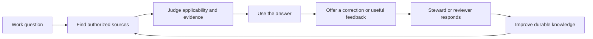

# Making governed knowledge easy, rewarding, and useful

Agent-to-agent product handoff · 2026-10-22 · engineering baseline and bounded decisions updated 2026-10-24

**Primary audience:** organizations running a governed knowledge platform, explicitly selected by the user during this investigation.

**Investigation:** `tsEpistle-m35`. **Implementation epic:** `tsEpistle-hnz`; work packages and dependencies appear below. Beads owns task status; this document owns the product rationale and acceptance contract.

**Reviewed source:** the original investigation used `7dc057de81f581e8f2d9bcf40eb2c338c284dba8`, matching its maintained local Wiki container. The engineering baseline below uses source and maintained image `e0a2ec211d332e14076ce4b7975af081ba68d08e`. The original investigation changed no application code, configuration, content, permissions, or services; the later baseline created and edited temporary synthetic content as explicitly described below. This remains a product acceptance contract, not release certification. The current Development Sprint authorizes bounded implementation; selecting a governed organizational audience does not activate Enterprise Release.

## The central insight

tsEpistle has developed strong mechanisms for preserving knowledge and controlling change. Its next product advance should make those mechanisms feel like a coherent, dependable way to get work done.

The intended experience is: **I can find an answer that applies to my situation, understand why I should trust it, use it, and safely help make it better.** For a contributor: **I know where my work is, who can see it, what happens next, and whether it helped.** For a reviewer: **I can make a good decision without reconstructing the system's execution history.**

The most consequential missing insight is that successful storage, retrieval, generation, and approval are intermediate events. The user's result comes later. A saved draft that cannot be found again, a cited answer that is inapplicable, and an approved edit that confuses readers can all be technically successful and product failures.

There is substantial existing value to connect. Search has scopes, previews, highlighting, stale-result protection, and offline handling. The reader has a strong outline and focus mode. Live Notes already publish snapshots as pages. Agent answers already preserve citations when copied or saved as private drafts. Ratings, passage discussions, resolution, watches, and notification preferences already exist. **Do not respond to this report by rebuilding these capabilities.** Improve the transitions and explanations around them.

For this audience, prioritize these decisions:

1. Define a few governed tasks and measure whether people complete them correctly.
2. Make applicability, audience, and next action understandable at the point of use.
3. Make contribution and review feel safe, recoverable, and worthwhile.
4. Add expressive delight where it reinforces understanding and accomplishment.

## Evidence and limits

Three independent source investigations covered reader activation, contribution, and Agent value. The synthesis also reviewed existing design documentation, the administrator dashboard, and telemetry implementation. Important findings were checked directly against current source. Existing design documents establish intention and historical checks; they do not prove today's entire product works.

Live observation used a fresh anonymous Chromium context through the installed Playwright 1.64.0 package, against the maintained local application at `http://127.0.0.1:3014/`:

| Observation | What it establishes | What it does not establish |
| --- | --- | --- |
| Reader captured and visually inspected at 1440×1000 and 390×844 CSS pixels | Existing reading layout, searchable desktop outline, collapsed phone contents, and direct phone Search are rendered | Signed-in member experience, physical-device ergonomics, all themes, full accessibility, or task success |
| Ctrl+K opened search; empty-query state inspected | Wiki/Saved offline/Glossary choices, current-page scope controls, minimum-query help, and operator guidance are present | That people understand the choices or know what to search for |
| An invented no-match query returned zero matches | Anonymous recovery copy suggests another term or broader scope | That knowledge is missing, or that permitted signed-in Ask controls are absent |
| Glossary selected in that anonymous context | This role reached an explicit permission-denied explanation | That organizational members have the same permissions or that the authorization boundary is defective |
| Escape closed search | That dismissal worked in this context | A comprehensive keyboard/focus audit |

The original investigation performed no Agent/provider request, authenticated editing, publishing, approval, notification delivery, fault injection, or user interview. The later native administrator attempts below extend that evidence; they do not retroactively validate the original observation set. The original phone Page Actions activator was exercised, but its contents were not established by the scoped menu-role lookup; mobile discovery conclusions below rely on source. Screenshots and instance article content are deliberately excluded from this repository handoff. No adoption, retention, speed, or satisfaction gains are claimed.

**Confidence:** high in the cited implementation facts; medium in the proposed interaction remedies; unvalidated in audience prevalence and business impact. Read “hypothesis” literally. An engineering baseline can justify bounded recovery work; it cannot substitute for observing organizational readers, contributors, and reviewers.

## Engineering pilot and baseline — not a human outcome study

This section records the `tsEpistle-hnz.1` engineering inputs and bounded decisions across `.2`–`.5`. Source inspection, native attempts, future acceptance, and unknown human outcomes are deliberately separate. None establishes a real recurring organizational job, named steward commitment, domain review, participant satisfaction, or adoption outcome.

### Current implementation acceptance — supersedes human/organizational dependencies

**Current user clarification:** implement a change only when it is generally helpful and its behavior can be demonstrated through agent-operated Playwright/native browser tests. If either condition cannot be established, skip it and close the corresponding speculative requirement with an evidence/rationale note rather than add speculative work or leave it as an implementation blocker. This instruction supersedes the original implementation dependency on participant studies, real organizational top jobs, steward appointments, domain-review policy, subjective effort, adoption or satisfaction outcomes. Those remain unknown, not completion blockers. The original insight/Acceptance paragraphs below are retained as product rationale and optional future research, not an obligation to recruit humans or leave the epic open.

Browser evidence can establish rendered state, authorized navigation, preserved drafts, explicit consent actions, safe rejection, receipts and recovery under controlled scenarios. It cannot establish unfamiliar users' comprehension, subjective effort, actual organizational relevance or adoption. Never relabel the former as proof of the latter. Use existing maintained authorized navigation only; do not create speculative task destinations, seed production content, or introduce persistent applicability/steward/review metadata. Operational creation receipts have the distinct bounded purpose described below.

| Candidate | Generally helpful, browser-provable scope | Disposition and limits |
| --- | --- | --- |
| Receipt and creation recovery | Preserve captured work; reopen the authoritative created artifact; read-only lost-response status; distinguish rejection/unknown; prevent duplicates and revoked disclosure. | Implement and exercise permitted/denied/unknown cases with synthetic fixtures. Source evidence justifies the design; success is not claimed until native acceptance runs. |
| Reader recovery | Query survives browse and return; empty results provide an authorized escape; existing Ask remains editable and unsent until explicit action. | Implement maintained-navigation recovery and test role, disabled-Agent, keyboard and phone cases. Skip invented organizational task links and ownerless escalation destinations. |
| Agent outcome and revision | Outcome facts and next actions are visible separately from budget; explicit denial/note and fresh review remain fenced; cancel/restate is explicit. | Implement only existing-contract behavior that can be exercised. Keep exact diff; skip rendered before/after under the current projection, new guidance semantics and new approval states. Human interpretation/decision accuracy remains unmeasured. |
| Contextual feedback | Vote remains a pure vote; optional discussion context is editable and unposted; reply/watch consent names its category/channel; declining preserves settings; revoked access discloses nothing. | Implement and exercise these concrete states using existing discussions/preferences. An actual permitted synthetic reply and resolved thread can be tested; organic stewardship responsiveness, subjective usefulness and workload are not required or claimed. |
| Applicability and human measurement | Optional authored examples can illustrate scope and distinguish editing, publication approval and domain review. | Retain the three examples below as opt-in authored examples only. Skip automated review badges, new content metadata, real-job/steward claims and human outcome collection as implementation deliverables. Any later voluntary study uses the privacy policy below, not a new analytics system. |

### Current source evidence and resolved premises

The following findings describe baseline revision `e0a2ec211d332e14076ce4b7975af081ba68d08e`, not current implementation acceptance. Links navigate the maintained source and may now contain the replacement behavior; baseline absence is not a claim that it remains absent. The independent capture, Agent/review, and reader/feedback investigations refine these premises; the current acceptance override above governs delivery scope.

| Baseline evidence | Decision and boundary |
| --- | --- |
| At baseline, [`WrittenPage` and `createPage`](../../client/helpers/pages-api.ts) returned page id, update time, and source revision; [note publication](../../client/components/notes/live-note.vue) and [answer draft creation](../../client/components/agents/agent-answer-actions.vue) discarded that receipt. [Note capture, now shared](../../shared/live-note-publication.ts#L10), records a note revision. | Preserve the existing receipt and distinguish captured note revision from committed page source revision. A new receipt is not a reason to rebuild ordinary page creation. |
| At baseline, [live-note summary](../../shared/live-notes.ts), [live-note persistence](../../server/db/migrations/tsepistle-000067-live-notes.ts), and [page insertion](../../server/models/pages.ts) stored no note/answer-to-page publication relationship. Existing [authorized page preview](../../server/operations/pages.ts) and [editor receipt reconciliation](../../client/helpers/pages-api.ts) required a known page identity. | The conditional lineage investigation was resolved: the baseline lacked durable origin/request proof for lost creation responses or reopening. Migration 68 adds the bounded receipt below; acceptance requires authoritative status and origin-inventory exercises. Recent-page lists, path availability, content similarity, and search absence cannot prove identity or rejection. |
| Baseline [publication error handling](../../client/components/notes/live-note.vue) treated every error as uncertain; [answer draft save](../../client/components/agents/agent-answer-actions.vue) had no equivalent ambiguous-attempt fence. Baseline [Page API error classification](../../server/controllers/api/pages.ts) did not cover all legacy create errors. | Separate definite response rejection from unresolved transport outcome. Lost-response success needs authoritative read-only reconciliation, not mutation replay. Legacy-error masking was a source-path finding, not an exercised native rejection result. |
| [Empty search and zero-result actions](../../client/components/common/search-results.vue#L107) already offer syntax help, filter clearing and authorized draft-only Ask; [header browse](../../client/components/common/nav-header.vue#L53) routes to `/t`, while [tag URL state](../../client/components/tags.vue#L809) has no search-draft intake. [Welcome](../../client/components/welcome.vue#L3) is an installation surface. | Do not claim search or Ask is absent. The gaps are task orientation and a query-preserving browse escape, especially when Ask is unavailable. Use maintained authorized navigation, not invented organizational destinations. |
| [Goal completion/outcome and proposal contracts](../../shared/agents/contracts.ts#L438) contain host-owned completion facts, diff, base revision and digests, but no canonical before/after bodies; [proposal projection](../../server/agents/projection.ts#L414) does not authorize such bodies. | Lead with factual outcome, limitations and next action, not resource percentage as accomplishment. **Rendered before/after is skipped:** the current projection supplies no authorized canonical bodies. Keep exact diff; do not create a new representation, reconstruct full bodies from a bounded diff or fetch latest content as the approved revision for this epic. |
| [Open-goal composer locks](../../client/components/agents/inline-agent-chat.vue#L819), [goal cancellation](../../server/agents/runtime.ts#L5302), and [decision contracts](../../shared/agents/contracts.ts#L656) already define explicit control paths. Proposal statuses have no `superseded` value. | Correct a misunderstood active goal through existing explicit cancel/restate, not hidden “Add guidance” semantics; pausing alone does not unlock ordinary submission. Revision feedback uses explicit denial plus `decisionNote` and a deliberate fresh draft/proposal. Preparing feedback is not cancellation, and denial is not a new request-changes ledger state. |
| [Ratings](../../client/components/wiki-page-ratings.vue#L218) are votes only; [discussion composition/reconciliation](../../client/components/comments.vue#L1003) and [resolve/reopen](../../client/components/comments.vue#L571) exist. [Category preferences](../../client/components/profile/notifications.vue#L37) default off, but [page-watch creation](../../server/operations/page-watching.ts#L307) defaults both page channels on. | Keep a negative vote pure. Optional context must remain an editable discussion draft until deliberate posting. Offer exact category/channel consent rather than silently using the bell as a narrow opt-in. Acknowledgment means an actual reply; resolution is thread state, not proof of a content correction. |
| [Reader provenance](../../client/themes/default/components/page.vue#L465) reports editing, and [existing Markdown admonitions](../../server/modules/rendering/markdown-core/admonitions.ts#L20) support authored applicability blocks. | Content-led applicability needs no new schema, certification badge, or production-content mutation. Modification time and publication approval do not establish domain validity. |

**Bounded receipt decision — current implementation contract.** [Migration 68](../../server/db/migrations/tsepistle-000068-page-creation-receipts.ts) adds private per-owner/request proof; [page insertion](../../server/models/pages.ts) commits page and receipt atomically with request serialization and owner/request uniqueness. The receipt binds immutable page id and committed source revision, not path identity, with optional captured live-note revision or owned Agent answer origin. [Read-only status and origin inventory](../../server/operations/pages.ts) recheck the current account, source access and destination source-read/password-unlock authority before projecting metadata. A deleted or revoked origin/destination yields only permitted generic committed/unavailable state. Missing receipt means unknown, never confirmed rejection. A definite validation/permission/conflict rejection permits deliberate correction with a new request id; never automatic repost. Validate the exact captured note revision/body, not the latest note. Multiple intentional publications remain independent snapshots with distinct request ids. Keep private origins out of public `page.extra`, OKF provenance, exports, and knowledge projections. This is operational proof, not analytics, two-way synchronization or a generic lineage framework; migration/recovery risks are documented in [deployment operations](../agents-deployment.md#current-creation-receipts).

Use the existing [page-visibility vocabulary](../../client/components/editor/common/page-visibility.ts#L34) for audience explanations. “Saved on this device,” “saved on the Wiki,” current access, publication state, and domain review answer different questions. “Public” is not unrestricted access; private note wording must not promise exclusion of administrators where existing policy permits system access.

### Native current-state attempts already observed

These are developer-operated synthetic attempts, not participant sessions or successful governed-task measurements.

| Attempt | Observed result | Limit |
| --- | --- | --- |
| Anonymous Chromium, desktop 1440×1000, loopback application: Ctrl+K and a synthetic no-match search | Search opened and returned zero matches with “No pages matching your query” and “Try a different term or a broader scope.” No Browse or owned request-help escape appeared. | Does not establish missing knowledge, signed-in member behavior, mobile recovery, or task comprehension. |
| Native administrator sign-in at the canonical tailnet origin | Genuine sign-in succeeded. A loopback sign-in was rejected with 403 by the exact-origin policy. | The denial is an authorization boundary working, not evidence that sign-in is generally broken. Administrator capabilities are not member-role evidence. |
| Settled administrator `/p/notes` inventory, blank-key creation, and CodeMirror editing of a synthetic private note | Inventory foregrounded optional Custom key before Create private note. Creation reached an editor, and the synthetic edit subsequently reached “All changes saved.” | Editor appearance included connecting state and is not a confirmed useful-outcome timing measurement. No task-success time, reader audience understanding, or safe-leave comprehension was measured. |
| Open the saved note's Publish as page form | Form showed captured revision 97, extracted title, blank destination path, Public selected, Published unchecked, body disclosure, and Create page once. Screenshot was visually inspected. | No page-creation mutation was performed in this form attempt. This does not validate publication, its receipt, reopening, rejection, or uncertain-outcome recovery. |
| Profile hydration during sign-in | An initial signed-in-required display settled into the correct form after authorization hydration. | A transient observation only; no defect is asserted from this attempt. |
| Native private-note creation with committed response deliberately lost | `POST /_api/live-notes` committed with 201 before its response was intentionally aborted. The existing UI showed a no-auto-retry warning and disabled Create. Reload inventory found the requested synthetic key; exactly one create POST occurred, and GET of that exact key returned 200. The attempt's own fixture was then deleted with 200. | Establishes committed/lost-response/manual-inventory recovery for **note creation only**, not page publication or durable publication-receipt recovery. No numeric task time, human comprehension, or adoption result was retained or inferred. |
| Synthetic Agent harmful-edit review in native Chromium | With genuine session identity checks intact and Agent responses supplied only by route fixtures, the exact diff for an unsupported release claim was visible. Deliberate Deny rendered “Change denied”; the current card had no feedback textarea. | No provider request or Wiki page write occurred. Establishes fixture-driven UI behavior, not a persisted server denial, real review accuracy or human comprehension. |
| Synthetic blocked/partial Agent goal in native Chromium | Host-fact fixtures supplied blocked status and partial completion. The collapsed view showed “Needs attention,” the synthetic objective, Run 2, “80% peak” and Show details. Expanding exposed missing evidence; ordinary composer input remained disabled while the goal was open. | Demonstrates current presentation and the open-goal composer fence under fixtures, not actual Agent accomplishment, perceived effort or successful objective correction. |
| Genuine notification-preferences form | `/p/notifications` displayed the current preferences form. Save preferences was disabled; no settings were changed. | Read-only form observation, not evidence of opt-in, notification delivery, reply receipt or consent-flow completion. |

These additional attempts used Node 24 and pinned Playwright 1.64.0. Recorded harness durations include setup, reloads or waits and are not human task times or achievement/improvement metrics.

The note was temporary synthetic baseline material, not organizational guidance. The lost-response attempt's own fixture was deleted as recorded above; that is not proof of a complete publication lifecycle or cleanup of any other fixture. Baseline source receipt-discard evidence is separate from the native form observation.

### Ranked interventions and future acceptance

1. **Receipt and creation recovery (`.3`) first:** the confirmed source-level loss of receipt/origin and risky ambiguous answer retry block trustworthy contribution/reopening. Exercise committed success with lost response, definite rejection, permission loss, and unknown outcome; preserve captured work, no duplicate writes, and no revoked metadata.
2. **Reader recovery (`.2`) next:** the native anonymous no-match dead end supports a query-preserving browse escape using maintained authorized navigation, with syntax help retained and request/Ask kept as an explicit editable draft. Skip speculative task links or invented steward routes; explain when a supported request route is unavailable.
3. **Agent interpretation and revision (`.4`):** use existing completion facts for complete/partial/blocked and next action, keep resource use distinct, and preserve exact-diff review with explicit denial/feedback/fresh approval. Active-goal correction stays explicit cancel/restate.
4. **Contextual feedback (`.5`):** optional contextual discussion and explicit reply/watch consent, preserving settings on decline, current identity/ACL invalidation, and default-off global preferences. Applicability examples are optional authored content, not a requirement to publish content or appoint stewards.

This ranking is an engineering decision from the stated evidence, not measured organizational cost. Delivery requires the generally helpful, browser-provable behavior in the current acceptance table, with its permission/revision/privacy fences. The original human-outcome aspirations remain visible but are intentionally not implementation prerequisites. Report native acceptance results only after the relevant scenarios actually occur; no human before/after sessions are required.

**Verification ownership:** `.1` source/native baseline proof is recorded above. Main owns final verification of `.2` reader recovery, `.3` receipt states/recovery, `.4` outcomes/denial, `.5` contextual feedback and `.6` inherited CI repair. Record exercised results and delivery status in those Beads issues; this product contract is not a CI, deployment or release-attestation record.

### Three executable authored-content examples — explicitly synthetic

These are optional, facilitator-ready authored examples and task scripts for a sanctioned synthetic pilot, **not existing production pages, real recurring jobs, assigned stewards, or reviewed procedures**. They are not required implementation tasks or authorization to seed content. Place the text only in an explicitly approved synthetic fixture if choosing to run the examples; this document creates no page, schema, access grant, or analytics. Use current controls for baseline attempts and proposed controls only after implementation. Record unavailability or failure rather than coach around it. No pilot execution or human result is claimed here.

**Synthetic job A — find the applicable procedure.** Supply an authorized fixture titled “SYNTHETIC — Training-room projector restart” with this body:

> **Use this when:** a training-room display is blank during the synthetic rehearsal and its status light is green.
>
> **Applies to:** the fictional training-room projector model A in this fixture only; no real equipment.
>
> **Responsible steward role (explicitly synthetic):** rehearsal facilities steward; no person is assigned and no response commitment exists.
>
> **Last domain review:** explicitly unverified; neither the fixture's edit date nor publication approval is a domain review.
>
> **Procedure:** check the selected input, reconnect the fictional display cable, then restart the fictional projector once. If the display remains blank, stop the rehearsal task.
>
> **Exceptions:** do not use this procedure for a red status light, unfamiliar model, or real electrical/safety problem.
>
> **Relevant next action:** consult the separately labeled synthetic “Model A input checklist” fixture to check the selected input; it is relevant because the first step depends on that choice. If unavailable or out of scope, state that no owned help route has been established; do not invent a real contact.

Give the reader a green-light/model-A prompt and then a red-light or model-B variant. Ask them to find the answer, explain applicability, source/review limits and next action, and say why the checklist is relevant before opening it. Repeat with a restricted fixture and a no-match term. Correctly declining inapplicable guidance or using a genuinely owned authorized escalation can succeed; inaccessible metadata must stay hidden. Failure to find an established escalation is recorded as blocked, not success.

**Synthetic job B — capture and deliberately publish knowledge.** Supply this seed for a private synthetic note titled “SYNTHETIC — Rehearsal handoff decision”:

> **Use this when:** preserving a fictional rehearsal decision for later editing and deliberate sharing.
>
> **Applies to:** the sandbox rehearsal only, not a real operational policy or permission to disclose information.
>
> **Responsible steward role (explicitly synthetic):** rehearsal knowledge steward; unassigned, with no response commitment.
>
> **Last domain review:** explicitly unverified; note save and page publication do not assert review.
>
> **Decision:** use the fictional blue room for the next rehearsal because its training display is available.
>
> **Exceptions:** no actual booking, customer information, credentials, or organizational approval belongs in this fixture.
>
> **Relevant next action:** deliberately create a private unpublished page snapshot in an approved sandbox destination, inspect its receipt and reopen it from the origin. Later note edits affect the note, not that independent page.

Ask the contributor to create privately, edit until server save is confirmed, predict audience and safe-leave state, then publish only to a sanctioned destination with explicit private/unpublished choices. Close and reopen the origin and find the created page without guessing by title/path; explain which object a later edit changes. Repeat controlled lost-response/rejection/permission-loss/unknown cases only in the authorized synthetic acceptance environment. An Agent-answer variant must preserve citations and private/unpublished defaults; it is not evidence that the note flow or Agent has already been exercised.

**Synthetic job C — safely review a harmful edit.** Supply an authorized proposal against a synthetic page containing this block:

> **Use this when:** deciding whether to approve a change to the fictional rehearsal stop rule.
>
> **Applies to:** synthetic editorial review only, never real safety guidance.
>
> **Responsible steward role (explicitly synthetic):** rehearsal safety-review steward; unassigned, with no authority asserted outside the fixture.
>
> **Last domain review:** explicitly unverified, even if a proposal is publication-approved.
>
> **Current rule:** if the fictional status light turns red, stop the rehearsal and do not restart it.
>
> **Exceptions:** a green light does not waive this stop rule once triggered; real equipment is outside scope.
>
> **Relevant next action:** compare the exact proposal diff against the stop rule, deny an unsafe change with an explicit reason, and deliberately prepare a corrected fresh proposal for separate review.

The harmful proposal changes “stop … and do not restart” to “continue … and restart once.” Ask the reviewer to identify target, material wording and consequence before deciding; a quick approval is failure. Use existing denial with a decision note, and cancel/restate explicitly if the active objective is wrong. A corrected proposal must receive fresh approval, never inherit the denied proposal's authority. Repeat stale/expired/revoked/destructive cases with their existing fences. Rendered before/after is not a baseline capability and cannot be presented as observed or authorized by this fixture.

Across all three examples, **edited** means canonical content/revision changed; **publication-approved** means the applicable publication decision authorized a bounded change under existing permissions, not that every page necessarily underwent approval; **domain-reviewed** means a real authorized subject-matter steward has explicitly checked stated scope, correctness, exceptions and review date under an agreed review practice. These are independent assertions. All three synthetic examples remain domain-review-unverified until such a practice and actual review exist; a recent edit, a citation, or Agent approval cannot promote them.

**Unknown human/organizational inputs — intentionally not prerequisites:** real recurring jobs, steward assignments and commitments, domain-review meaning and authority, response expectations, audience comprehension, cost of a wrong decision, perceived effort, adoption and satisfaction. Do not invent them, substitute administrator intuition, or require them to complete the browser-provable engineering scope. The examples do not certify domain validity, compliance or universal accuracy; any later real-content program or human study is a separate voluntary decision.

## The user journeys to optimize

These are role hypotheses for the selected audience, not newly proposed account roles or grants. One person may perform several jobs.

| User's job | Useful result | Cost of a poor experience |
| --- | --- | --- |
| Reader: answer a work question | Finds applicable information and can take the next step with appropriate confidence | Repeated questions, incorrect decisions, or avoidance of the knowledge platform |
| Contributor: improve shared understanding | Captures a thought, reaches the intended audience, and can find/revise it later | Abandoned drafts, duplicate pages, accidental audience assumptions |
| Reviewer: authorize a consequential change | Understands the material change and its consequence; accepts, declines, or requests revision accurately | Rubber-stamping, review fatigue, avoidable reverts |
| Knowledge steward: keep an area useful | Recognizes gaps, answers feedback, and knows which guidance needs review | Growing page inventory without reliable organizational knowledge |
| Operator: make these paths available safely | Understands which roles/capabilities are enabled and can diagnose a blocked task | Capability confusion and users depending on an administrator for ordinary work |

The product loop should be visible across those roles:

A useful answer can complete the task immediately. Do not force saving, commenting, Agent use, or another visit to count the experience as successful.

## Eight original insights — rationale, not superseding acceptance

“Observed” in this section describes the investigation/baseline, not a fresh check of the changed implementation. Original human-oriented Acceptance paragraphs remain research aspirations only. Current delivery is limited to the concrete browser-provable table above; real-job/steward appointments, subjective/adoption measurements, invented owned escalation, new applicability metadata/badges/analytics, rendered before/after and new active-goal guidance are skipped with the stated evidence, not blockers.

### 1. Activation is a completed work task, not exposure to features

**Observed.** Empty search teaches title/content/path/tag search and operators ([search-results.vue](../../client/components/common/search-results.vue#L111), lines 111–126). Agent starters offer summary/exploration, connections, and recent-page catch-up ([inline-agent-chat.vue](../../client/components/agents/inline-agent-chat.vue#L313), lines 313–347 and 973–980). The initial welcome component offers home creation and administration ([welcome.vue](../../client/components/welcome.vue#L3), lines 3–13); that is an installation/content-owner state, not evidence of member onboarding. The live anonymous search matched the source description.

**Missing insight.** An organizational newcomer often lacks the vocabulary, context, and confidence to invent a useful query. The organization also has to supply useful starting content. A feature tour cannot compensate for an empty or poorly maintained knowledge base.

**Current prescription.** Keep syntax help, maintained authorized browse navigation and the existing editable Ask handoff when enabled. Preserve the query across browse/return. **Real organizational task starters are skipped:** no actual recurring jobs, maintained task destinations or authorized steward appointments were established. Do not invent or seed them to satisfy this epic.

Task starters must reflect live permissions and enabled capabilities. An Agent-disabled organization still needs a complete reader journey. A blocked destination should explain a legitimate next step without revealing restricted metadata. The observed anonymous Glossary denial is a useful role-test case, not a reason to weaken authorization.

**Acceptance.** Unfamiliar participants can identify a relevant task, reach an applicable answer or an owned escalation, and explain their next action without coaching. Include empty content, restricted content, disabled Agent, keyboard, and 320/390px cases. Measure time to a confirmed useful outcome and wrong turns; starter clicks are only diagnostics.

**Delivery:** `tsEpistle-hnz.1` → `tsEpistle-hnz.2`.

### 2. Governance must be understandable at the moment of action

**Observed.** Live Notes distinguishes saved/pending states, sharing access, and publication. Publication separately asks for Public/Private and Published, and explains that it creates an independent captured revision ([live-note.vue](../../client/components/notes/live-note.vue#L15), lines 15–58 and 115–121). The ordinary editor already distinguishes server/device saves and visibility ([editor.vue](../../client/components/editor.vue#L910), lines 910–950). Agent answer saves explicitly create private, unpublished pages ([agent-answer-actions.vue](../../client/components/agents/agent-answer-actions.vue#L91), lines 91–105).

**Missing insight.** “Saved,” “shared,” “published,” “approved,” and “verified” answer different questions. A technically correct control can still leave a user unable to predict the consequence. In a governed organization, uncertainty about audience discourages useful contribution as well as risking inappropriate sharing.

**Prescription.** Use a consistent presentation of three independent facts: where the current work is saved, its current audience under site permissions, and its publication/review state. Use authoritative state already available. If effective audience cannot be enumerated safely, say “Available under this page's access rules” and expose the relevant authorized explanation; do not invent a list of people or claim “everyone.” “Public” must never be translated into unrestricted access without evidence.

Before a note becomes a page, summarize destination, captured revision, intended audience, and draft/published consequence. Example wording, contingent on real state: “Create a draft page from revision 12. Later note edits will stay in this note.” Keep detailed paths and locale codes available without making them the first conceptual hurdle. Explain ordinary next steps for unavailable capabilities; do not enable capabilities as an onboarding shortcut.

**Acceptance.** Across private/shared notes, draft/published pages, device-only drafts, disconnected edits, and access revocation, people correctly answer “Who can see this?” and “Can I safely leave?” Status must not stay reassuring after account or permission changes. Essential state must be accessible without relying on color or a tooltip.

**Delivery:** `tsEpistle-hnz.3`; terminology decisions established in `tsEpistle-hnz.1`.

### 3. A contribution is valuable when its lifecycle is easy to follow

**Observed.** Note creation foregrounds an optional custom key, even though leaving it blank already generates an address ([profile/notes.vue](../../client/components/profile/notes.vue#L3), lines 3–14 and 48–55). Note publication captures a revision, requires a destination, creates an ordinary page, and keeps the success link in component state ([live-note.vue](../../client/components/notes/live-note.vue#L242), lines 242–265). The inspected note summary carries no publication relationship ([shared/live-notes.ts](../../shared/live-notes.ts#L9), lines 9–22). Agent answers already have copy-with-citations and private-draft review, including generated destination defaults ([agent-answer-actions.vue](../../client/components/agents/agent-answer-actions.vue#L3), lines 3–24, 55–83, and 91–105).

**Missing insight.** Capture, storage, and publication are separate successful requests, but the contributor experiences one continuing piece of work. They need to answer “Did I already turn this into a page?”, “Where should the next edit happen?”, and “Can someone else use it?” More drafts are not automatically more impact.

**Prescription.** Lead note creation with the thought and its private state; move custom addressing into optional details. Offer a few relevant, dismissible starting structures, such as a decision explanation or a question to resolve, while preserving blank capture. For Agent drafts, foreground title and understandable destination; preserve the citation-bearing preview and private-save contract.

Make publication success a useful result: destination, audience, captured revision, and a clear way to continue on the page. The baseline investigation above resolves the provenance question: the response receipt exists, but a durable origin/request relationship does not. Add only the smallest private, atomic authorized receipt needed for reopening and read-only uncertainty recovery. Preserve intentional multiple publications and handle deleted/inaccessible destinations without leaking names or paths. Do not introduce automatic two-way note/page synchronization.

**Acceptance.** After closing and reopening, contributors find the result from the originating workflow and can explain which object future edits affect. An updated note must not imply its published page also changed. Citations survive answer export. Reuse and appropriate publication are outcomes; orphaned or unused drafts are countermetrics.

**Delivery:** `tsEpistle-hnz.3`. The baseline supports the bounded receipt decision above; it does not justify a general lineage framework.

### 4. Recovery should reduce uncertainty without replaying risky work

**Observed.** An uncertain note creation tells the user to reload the inventory and locate the result ([profile/notes.vue](../../client/components/profile/notes.vue#L56), lines 56–61). A caught publication error marks the attempt uncertain, prevents resubmission, and tells the user to check pages before another publication ([live-note.vue](../../client/components/notes/live-note.vue#L254), lines 254–270). Pending-change and download escapes already exist. Search zero-results recovery already supports applicable clear-filter and draft-only Ask actions ([search-results.vue](../../client/components/common/search-results.vue#L165), lines 165–184); the anonymous role had generic recovery copy.

**Missing insight.** Preserving data is necessary; making the person investigate whether their work exists is still costly. Likewise, a failed search may be a vocabulary problem, an access/scope limit, or a content gap. Those cases need different next actions.

**Prescription.** For uncertain creation, offer an explicit read-only authoritative receipt check. Report committed or still unknown; only a definite rejecting mutation response establishes rejection, never missing receipt or search absence. Preserve captured text and avoid inaccessible-destination disclosure. Recovery must not replay the mutation.

For failed discovery, offer query-preserving maintained browse and retain editable, unsent Ask with current authorization and stale-result protection. **An owned “Request missing information” route is skipped:** no organizational destination, steward or response contract was established. State unavailable supported actions honestly; do not invent an escalation or automatically send query text to a person or model.

**Acceptance.** Exercise committed success with lost response, definite rejection, permission loss, and unresolved transport failure. No duplicates, false absence, or lost captured work. Separately test a wrong term, excessive filters, and a genuinely missing answer: each leads to a useful authorized recovery action rather than indefinite reformulation.

**Delivery:** creation recovery in `tsEpistle-hnz.3`; discovery recovery in `tsEpistle-hnz.2`.

### 5. Explain Agent accomplishment independently of resource consumption

**Observed.** The collapsed goal emphasizes status, objective, run count, and peak resource percentage. The expanded meter is correctly labeled resource use. Its percentage is the maximum of token, tool-call, and continuation consumption; completed explanatory copy is based on run count ([agent-goal-status.vue](../../client/components/agents/agent-goal-status.vue#L12), lines 12–24, 63–85, 331–339, and 464–476). The contract has a completion assessment, not a verified milestone model ([contracts.ts](../../shared/agents/contracts.ts#L438), lines 438–464).

**Missing insight.** Accounting is essential for governance but cannot answer “How much of my objective is accomplished?” High spending can accompany little useful progress. This report does not accuse the existing meter of falsely labeling itself task completion; the opportunity is the hierarchy and missing outcome explanation.

**Prescription.** Lead with established facts: what was found or changed, unresolved limitations, and the user's next necessary decision. Completion should link to the relevant answer or artifact and disclose remaining issues. Keep costs, resource use, deadlines, and renewal controls accessible, with salient limit warnings. Derive summaries from existing authoritative run/proposal/task facts. If reliable milestones are unavailable, show factual status rather than fabricate a percentage or a model-written checklist presented as verified progress.

Open goals restrict ordinary submission ([inline-agent-chat.vue](../../client/components/agents/inline-agent-chat.vue)), including when paused. Correction uses existing explicit cancel/restate; proposal-specific feedback uses denial with a decision note and a deliberate fresh draft/proposal. Preserve those fences in controlled browser scenarios. **New active-goal guidance is skipped:** existing contracts provide explicit cancellation, not defined pause/queue/guidance semantics; inventing them would expand run authority and accounting scope.

**Acceptance.** Users correctly interpret active, blocked, partial, budget-limited, and completed scenarios and identify the next action. Resource consumption and objective achievement remain distinct. A completion assessment with unresolved issues cannot become an unconditional success claim. Measure interpretation and correct next action; retain cost per successful task as a separate diagnostic.

**Delivery:** `tsEpistle-hnz.4`.

### 6. Reviewer attention is a scarce product resource

**Observed.** Agent approval already includes a summary, risk, target, timing, expandable verification details, and exact line diff. Decisions are deny/apply; destructive requests require an exact path ([agent-tool-card.vue](../../client/components/agents/agent-tool-card.vue#L27), lines 27–143). This is strong existing control, not a missing approval system.

**Missing insight.** Requiring approval does not ensure an informed decision. A nontechnical reviewer may understand whether an explanation is accurate more easily in rendered prose than in a diff. A nearly right proposal needs a revision path; binary acceptance alone can create either rubber-stamping or abandonment.

**Current prescription.** Keep the exact diff with target, consequence and supported evidence visible. **Rendered before/after is skipped**, because [AgentProposalView](../../shared/agents/contracts.ts) exposes diff, revision and digests, not authorized canonical before/after bodies. Do not add a new projection, fetch latest content or reconstruct authoritative bodies from a bounded diff for this epic.

Use an editable denial note through the existing decision path, then a deliberate fresh draft/proposal requiring fresh approval. Show the former proposal's actual persisted state; there is no new request-changes or superseded ledger state. Preparing feedback neither cancels a proposal nor sends a new request. Preserve expiry, base-revision checks, live authorization, destructive confirmation, run locks, accounting and the exact approved operation.

**Acceptance.** Reviewers identify the page, material wording change, and consequence before deciding. Include a plausible but materially incorrect edit: rejecting it matters more than approving quickly. Test stale, denied, expired, revoked, and destructive cases, plus revision after feedback. Measure decision accuracy first, then time and successful revision; approval rate alone is not a success metric.

**Delivery:** `tsEpistle-hnz.4`.

### 7. Knowledge needs applicability and stewardship, not merely freshness

**Observed.** Reader provenance shows modification time and optional editor identity ([page.vue](../../client/themes/default/components/page.vue#L461), lines 461–471). Approval controls and permission gating already exist (lines 364–380). Links exposes incoming/outgoing relationships with titles and paths ([wiki-page-links.vue](../../client/components/wiki-page-links.vue#L7), lines 7–47). Catch Up selects a recent-pages starter ([inline-agent-chat.vue](../../client/components/agents/inline-agent-chat.vue#L979)); the maintained [Agent workspace description](../agent-workspace.md) explicitly describes bounded recent-page excerpts rather than revision comparison.

**Missing insight.** Modification time, publication approval, source support, and domain validity are distinct. An answer can accurately cite an outdated procedure. A recent digest can be accurate and irrelevant. A backlink can be correct without explaining why the reader should follow it.

**Disposition.** Authored applicability blocks remain optional examples, not a required content pilot or production seeding. Skip real steward appointments, domain-review policy, new applicability metadata and certification badges: no organizational authority or validated domain-review meaning is established. Modification time, AI confidence and publication approval must not imply domain verification.

Suggested task links and catch-up comparison remain outside this bounded slice: no maintained organizational next-step content or last-visit comparison baseline was established. Existing links and recent-page navigation remain available under current permissions; recency must not imply domain review or “changes since your last visit.”

**Acceptance.** Readers can judge whether guidance applies and identify who can resolve a problem. Test a recently edited but not domain-reviewed page and an old but still valid page. Participants can explain why a suggested next resource is useful before opening it. Track wrong decisions, unresolved applicability questions, and useful reuse; more link clicks or digest pages are not intrinsically better.

**Delivery:** no new applicability implementation in this epic; `tsEpistle-hnz.5` retains only contextual feedback and consent below.

### 8. Make contribution rewarding by closing the human feedback loop

**Observed.** Ratings support votes, removal, and aggregate feedback ([wiki-page-ratings.vue](../../client/components/wiki-page-ratings.vue#L22), lines 22–113). Passage annotations and missing/ambiguous anchor explanations exist ([discussion-annotations.vue](../../client/components/common/discussion-annotations.vue#L2), lines 2–18 and 61–89). Discussions support resolve/reopen ([comments.vue](../../client/components/comments.vue#L191), lines 191–200 and 571–592). Watches exist; reply, mention, and watched-comment channels default off ([profile/notifications.vue](../../client/components/profile/notifications.vue#L37), lines 37–50). Notification audience discovery respects enabled preferences and watchers/participants ([notification-audience.ts](../../server/jobs/notification-audience.ts#L244), lines 244–257).

**Missing insight.** A contributor's satisfying moment is often learning that someone used the work or seeing a question become clearer. The ingredients exist, but users must discover several independent controls to assemble that experience. A negative vote also cannot tell a steward what task was blocked.

**Prescription.** After a contribution, offer a dismissible, explicit choice to follow replies or the page, explaining the exact category/channel affected. Keep existing preferences and off-by-default policies. Reply consent patches only `commentReply.inApp`; rereading preferences before Save must not replay a whole snapshot and overwrite concurrent Email or other category changes. A negative rating may offer an optional, previewable discussion draft asking what the person was trying to do and which passage blocked them. First opening the discussion must retain that draft: lazy visibility activation must not cancel an explicit handoff's authorization read. Casting the vote alone must not post text or subscribe the voter.

Exercise existing acknowledgment and resolve/reopen with permitted synthetic replies and threads. A reply, resolution and actual content correction remain distinct facts. **Real stewardship practice and response commitments are skipped:** no organizational owner or responsiveness evidence exists, and a controlled browser flow cannot establish them. No new inbox, leaderboard, quota, analytics or forced streak is required.

**Acceptance.** A contributor deliberately opts into an existing notification channel, receives a permitted reply, opens the relevant thread, and sees a useful resolution. Declining changes nothing. Permission loss must prevent disclosure. Measure actionable reports, acknowledgment/resolution time, contributor-rated usefulness, and steward workload. Keep the ability to ignore or turn off feedback.

**Delivery:** `tsEpistle-hnz.5`.

## What “fun” should mean in this product

The strongest design hypothesis is a combination of agency, growing competence, and reciprocal usefulness. Users choose their next step, understand what the system did, and see their work improve another person's task. This interpretation draws on self-determination research; it is not evidence that a particular tsEpistle feature will improve retention. [Self-Determination Theory overview](https://www.selfdeterminationtheory.org/theory).

Express that hypothesis through the existing product identity:

- **Relief:** reliable save/audience feedback, understandable recovery, reversible local edits.
- **Mastery:** useful defaults, examples that teach by doing, deeper controls when needed.
- **Discovery:** a relevant connection or worked example that makes something click.
- **Contribution:** a real reply, acknowledged correction, or useful resolved question.
- **Craft:** clear typography, responsive controls, calm transitions, and a completion receipt worth reading.

Retain the editorial serif/gold direction, focus reading, stable keyboard interaction, mobile touch targets, and reduced-motion behavior documented in [Reading and discovery](reading-and-discovery.md). Further animation should have a purpose and never delay content, hide errors, compete with review, or imply success before confirmation. Test the words “I felt confident,” “I felt in control,” and “This was satisfying” with participants instead of equating fun with visual novelty.

## Measurement before another feature wave

**Optional future research, not a delivery gate.** The current clarification removes participant recruitment, organizational job selection and subjective measurements from this implementation's prerequisites. The manual policy below is retained for a separately opted-in future study; no study, analytics capture, participant count or outcome is claimed. Agent browser scenarios report exercised behavior and artifacts, not the human successful-governed-task rate.

The administrator dashboard currently emphasizes inventory: pages, tags, users, groups, assets, storage, and comments ([admin-dashboard.vue](../../client/components/admin/admin-dashboard.vue#L188), lines 188–244). The inspected telemetry service's `sendEvent` is a reserved no-op; instance events concern installation/runtime metadata ([telemetry.ts](../../server/core/telemetry.ts#L74), lines 74–92 and 158–173). These facts do not establish that the entire installation has no analytics. They establish that these inspected surfaces do not answer the outcome questions in this report.

Use **successful governed-task rate** as the initial manual, opt-in product measure, not an application analytics feature. **Denominator:** every consented, eligible task attempt actually started in the declared pilot window, including incorrect, blocked, abandoned, or still-unknown outcomes. Eligibility is agreed before the attempt: declared role/job, sanctioned content, capability/access scenario, and a task-specific correct-result rubric. A deliberate restricted/disabled scenario is eligible when testing a safe explanation or recovery; do not exclude it after a failure. **Numerator:** denominator attempts with a confirmed useful and correct result (or the rubric's legitimate authorized escalation/safe refusal), correct source/applicability and audience understanding, correct next action, and no avoidable rescue, unauthorized disclosure, duplicate creation, or harmful approval. Required governance approval is not “avoidable intervention.” Incomplete/unassessed comprehension or unverified self-reported accuracy cannot enter the confirmed-success numerator. Report `successful attempts / eligible attempts`, not just a percentage; zero attempts means not measured, not zero percent.

Keep directly observed and voluntary self-reported attempt counts separate, including their verification limitations, and separate synthetic engineering scenarios from human task attempts. A retry/recovery within one assigned job remains the same attempt, not a new success opportunity. Record pre-start exclusions with reasons and separately report consent withdrawals without retaining withdrawn records or quietly treating failures as ineligible. Compare like task/role/scenario categories before and after; no opt-in sample supports extrapolation to all users. A search click, page save, model completion, or approval alone does not demonstrate success.

For each consented attempt, use a minimal manually recorded row; no rows for real participants have been collected in this handoff:

| Field | Record and scoring rule |
| --- | --- |
| Context | Random pilot attempt code, baseline/changed revision, synthetic versus sanctioned-real task, declared role category (not account identity), job/scenario code, allowed capabilities and device/input category. No claim that a scenario is a real recurring job without organizational confirmation. |
| Time | Elapsed time from accepting the task to confirmed outcome or explicit stop, with interruption flag and stop reason. Record “not measured” if unavailable; editor mount, HTTP latency, or waiting for a component is not task-success time. Establish any acceptable threshold only after the baseline. |
| Result accuracy | Correct / incorrect / unverified against the predeclared rubric; useful result or legitimate escalation; harmful-edit decision correctness; next-action correctness; failure category and avoidable help/wrong-turn count. Preserve harmful approval and wrong-audience failures separately rather than average them away. |
| Source comprehension | Participant explains applicability, evidence/review limits, exceptions and why the next resource helps; record correct / incorrect / unassessed, not an inferred score from a click or citation. |
| Audience and save comprehension | Participant predicts who may access the object under current rules, draft/publication consequence, safe-leave state and note/page independence; correct / incorrect / unassessed. Administrator access must not be silently excluded. |
| Recovery | None needed, or scenario and confirmed / rejected / unknown / blocked result; captured work retained, duplicate avoided, access respected, and whether the person found the receipt/result after reopening. “Not visible” never proves “not created.” |
| Perceived effort | Optional participant-reported 1–5 response to “How much effort did this task take?” (1 very low, 5 very high), plus declined/not asked. Confidence, control and satisfaction may each be asked separately and optionally; they are not inferred from speed, completion, or facilitator opinion. |
| Follow-through | Only if separately consented and actually observed: later useful reuse, actual steward reply/acknowledgment, thread resolution versus actual content change, response interval and steward effort. Otherwise record not observed; no invented reply or reuse outcome. |

**Pilot privacy and retention policy (required before recruiting, not an assertion of deployed policy):** participation and any follow-up are explicit, voluntary opt-ins, with purpose, fields, access and deletion date explained first; declining changes no product access, settings or notifications. Collect no raw searches, prompts, article bodies, titles, private paths, account ids, emails, screenshots, audio/video, or employee productivity rankings in the measurement rows. Record coded failure categories rather than sensitive verbatim remarks. Use synthetic content by default; sanctioned real content stays under its existing ACLs and is not copied into the measurement record.

Keep row-level notes encrypted in an organization-approved restricted location, outside this repository, application telemetry and issue attachments; access only for the explicitly designated pilot facilitator/evaluator. Before collection the organization must assign that real custodian and approve the location; none is appointed by this document. Delete row-level records and any separately consented contact/code mapping on withdrawal or at most 30 days after the session, whichever is earlier. Keep contact details separate and only for the requested follow-up. Retain de-identified aggregate results for at most 90 days after pilot close, then delete; a different period requires fresh explicit agreement before collection, not silent extension. Do not join records to account, provider or external telemetry logs or export them to an analytics vendor. Share only consented aggregates; suppress potentially identifying role/job breakdowns with fewer than three attempts and any revealing narrative. An overall small-sample numerator/denominator may be reported with consent and clear sampling limits, never individual performance attribution. These are pilot handling rules, not a compliance certification or implementation of an analytics system.

| Dimension | Initial evidence | Countermetric / interpretation guard |
| --- | --- | --- |
| Easy | Task completion, time, wrong turns, help required, recovery success | Fast but wrong answers; expert-only shortcuts |
| Rewarding | Brief post-task confidence/control/satisfaction questions; qualitative hesitation | Coerced participation, notification burden, distracting motion |
| Impactful | Correct use of guidance, useful correction resolved, artifact found/reused in a later task | Page/chat volume, unused drafts, unnecessary repeat visits |
| Governed | Audience comprehension, source applicability, reviewer decision accuracy | False “verified” signals, unauthorized metadata, mistaken approvals |
| Sustainable | Steward review effort, unresolved requests, cost per useful Agent task | Growth in queue size or token spending without improved outcomes |

If a separate voluntary human study is later chosen, start manually; the original suggestion of 6–8 participants across readers, contributors, reviewers and an operator is only a formative-study idea, not a recruitment commitment or a condition of this implementation. Organizational jobs and authorized content would need to be agreed for that study alone. Compare the same task categories before and after, and report harmful approval/wrong-audience failures separately. Establish acceptable task-specific times only after an actual baseline; this report invents no uplift or performance target.

If later instrumentation is justified, separately authorize its purpose, fields, retention, access and opt-in policy before implementation. Prefer local aggregate task/state outcomes; the pilot policy above does not authorize production event capture. Distinct users and later reuse require an explicit privacy design; manual consented follow-up is sufficient for the pilot. Do not repurpose external instance telemetry without review of its actual policy and destination.

This follows the general practice of deriving measurements from user goals, rather than selecting convenient activity counts. [Google Research: HEART and mapping product goals to metrics](https://research.google/pubs/measuring-the-user-experience-on-a-large-scale-user-centered-metrics-for-web-applications/).

## Implementation handoff and sequence

The receiving agent owns bounded implementation and verification under the repository's active instructions. The original investigation authorized the report and task filing only; the current Development Sprint authorizes implementation of the validated bounded slices, not runtime-policy changes or Enterprise Release. The original investigation was document-only; implementation requires the changed-path checks, affected-service build/deployment and focused runtime exercises. Main owns integration and verification; no source claim or proposed script above substitutes for those results.

| Bead | Priority / ownership | Concrete deliverable | Dependency and stop condition |
| --- | --- | --- | --- |
| `tsEpistle-hnz.1` | P1 · engineering baseline/documentation owner | Source/native baseline proof and bounded acceptance disposition recorded above | Baseline proof done; Main retains final validation/closure. Human/org evidence is skipped, not a blocker. |
| `tsEpistle-hnz.2` | P1 · reader/frontend agent | Query-preserving search/browse recovery using maintained authorized navigation | Use `.1` engineering evidence. Browser-demonstrate role/mobile/keyboard recovery; skip ungrounded task links and owned-help claims. |
| `tsEpistle-hnz.3` | P1 · contributor/frontend agent; server owner only where required | Clear capture/save/audience/publication states, useful destination receipts, read-only uncertainty recovery | Use `.1` engineering evidence. Demonstrate reopening, loss/rejection/unknown and authorization fences; no human-comprehension dependency. |
| `tsEpistle-hnz.4` | P1 · Agent interface owner with authority-boundary review | Outcome-led facts and explicit editorial feedback/fresh-review flow | Browser-demonstrate existing-contract states with preserved revision/approval/run/accounting fences. Skip rendered before/after and hidden guidance semantics. |
| `tsEpistle-hnz.5` | P2 · feedback/frontend agent | Deliberate contextual report and notification consent using existing discussions/preferences | Browser-demonstrate draft/post/decline/reply/resolution and ACL behavior. Optional authored examples require no production seeding or new metadata; human stewardship/reuse metrics are not blockers. |
| `tsEpistle-hnz.6` | P1 · inherited CI fixture owner | Repair offline browser startup fixture without weaker assertions, retries, skips or global deadline increases | Main verifies focused files, complete fast checks and pushed-revision CI; no pass asserted here. |

The engineering baseline ranks receipt/recovery first, reader recovery second, Agent interpretation/revision third, and contextual feedback fourth, for the explicit reasons above. Complete or explicitly skip each candidate under the generally-helpful/browser-provable rule, preserving all applicable authority and data-safety fences. No `.1` human dependency remains. The dependency graph permits independent engineering work, not four mandatory simultaneous feature projects. A newly observed severe audience-state error or failed recovery outranks cosmetics; reprioritize from evidence and record the reason in Beads.

The original optional human baseline scripts below remain as rationale for future research, not as current delivery dependencies. Agent tests may use corresponding synthetic scenarios to demonstrate visible behavior, but must not claim they demonstrate human comprehension or perceived effort:

1. A new reader finds the applicable procedure, explains its scope, and identifies the responsible steward; repeat with a restricted or missing answer.
2. A contributor captures a private question, turns a useful answer into a deliberate page draft, and locates it after a later session.
3. A contributor encounters a lost creation response and tries to determine what happened using current recovery controls, without blindly resubmitting.
4. A reviewer spots a plausible incorrect edit and attempts to get it corrected using existing denial/manual-feedback controls. Record friction and whether stopping an open goal is necessary; the proposed Request changes flow belongs in later acceptance testing.
5. A person interprets a blocked or partially successful Agent goal and takes the correct next action.
6. A contributor tries to follow a reply, resolve an authorized passage question, and find what changed using current watch/preferences/discussion controls. Test permission loss and declining notification changes as well; contextual opt-in is proposed work.

For implemented UI slices, require focused behavioral coverage and native browser exercise at representative desktop and phone widths, plus relevant keyboard, reduced-motion, denied, stale, loading, empty, and error states. Use synthetic fixtures for mutation/failure cases. Source tests and screenshots alone do not establish the flow. Follow the repository's changed-path typecheck/build/deployment requirements when implementation is actually undertaken; do not broaden this into a release program.

Human-AI guidance supports making capabilities and limitations understandable, enabling correction, and conveying consequences. It motivates the direction here; it does not validate these exact UI choices or guarantee safe decisions. [Microsoft Research: Guidelines for human-AI interaction](https://www.microsoft.com/en-us/research/blog/guidelines-for-human-ai-interaction-design/).

## Decisions to preserve and questions still open

Preserve canonical Markdown/revisions, live authorization, proposal-first Agent writes, exact approval scope, current accounting, private draft defaults, notification consent, and disabled capabilities. Preserve citations and source previews. Source-grounded AI can be useful without being a domain authority. Human editing and Agent proposal paths must retain their distinct existing contracts.

Do not introduce a new recommendation engine, universal content schema, compliance badge, gamification system, analytics vendor, notes/page synchronization framework, or broad navigation redesign on the strength of this report. Their value is not established. The existing open MCP client-compatibility issue `tsEpistle-1lw` is separate and was not duplicated into this epic.

Real organizational jobs, user vocabulary, review ownership and response expectations, human audience comprehension, and wrong-decision costs remain unknown. They are intentionally not prerequisites for generally useful, browser-provable changes; skip work that depends on inventing those facts. Actual authorization policy and enabled capability boundaries must still be respected and exercised through the available system state.

The original product aspiration remains useful work, understandable consequences, confident recovery and knowledge that helps someone. Current implementation acceptance is the narrower, explicitly authorized engineering rule above—not a claim that those human outcomes have been achieved and not an instruction to leave the epic open awaiting them.
