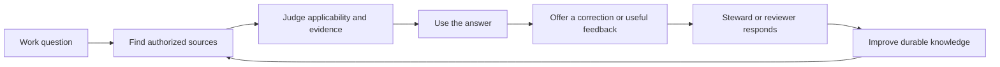

# Making governed knowledge easy, rewarding, and useful

Agent-to-agent product handoff · 2026-10-22

**Primary audience:** organizations running a governed knowledge platform, explicitly selected by the user during this investigation.

**Investigation:** `tsEpistle-m35`. **Implementation epic:** `tsEpistle-hnz`; work packages and dependencies appear below. Beads owns task status; this document owns the product rationale and acceptance contract.

**Reviewed source:** `7dc057de81f581e8f2d9bcf40eb2c338c284dba8`. The maintained local Wiki container reported that same revision. No application code, configuration, content, permissions, or services were changed. This is a product investigation and implementation handoff, not release certification. Selecting a governed organizational audience does not activate Enterprise Release.

## The central insight

tsEpistle has developed strong mechanisms for preserving knowledge and controlling change. Its next product advance should make those mechanisms feel like a coherent, dependable way to get work done.

The intended experience is: **I can find an answer that applies to my situation, understand why I should trust it, use it, and safely help make it better.** For a contributor: **I know where my work is, who can see it, what happens next, and whether it helped.** For a reviewer: **I can make a good decision without reconstructing the system's execution history.**

The most consequential missing insight is that successful storage, retrieval, generation, and approval are intermediate events. The user's result comes later. A saved draft that cannot be found again, a cited answer that is inapplicable, and an approved edit that confuses readers can all be technically successful and product failures.

There is substantial existing value to connect. Search has scopes, previews, highlighting, stale-result protection, and offline handling. The reader has a strong outline and focus mode. Live Notes already publish snapshots as pages. Agent answers already preserve citations when copied or saved as private drafts. Ratings, passage discussions, resolution, watches, and notification preferences already exist. **Do not respond to this report by rebuilding these capabilities.** Improve the transitions and explanations around them.

For this audience, prioritize these decisions:

1. Define a few governed tasks and measure whether people complete them correctly.
2. Make applicability, audience, and next action understandable at the point of use.
3. Make contribution and review feel safe, recoverable, and worthwhile.
4. Add expressive delight where it reinforces understanding and accomplishment.

## Evidence and limits

Three independent source investigations covered reader activation, contribution, and Agent value. The synthesis also reviewed existing design documentation, the administrator dashboard, and telemetry implementation. Important findings were checked directly against current source. Existing design documents establish intention and historical checks; they do not prove today's entire product works.

Live observation used a fresh anonymous Chromium context through the installed Playwright 1.64.0 package, against the maintained local application at `http://127.0.0.1:3014/`:

| Observation | What it establishes | What it does not establish |
| --- | --- | --- |
| Reader captured and visually inspected at 1440×1000 and 390×844 CSS pixels | Existing reading layout, searchable desktop outline, collapsed phone contents, and direct phone Search are rendered | Signed-in member experience, physical-device ergonomics, all themes, full accessibility, or task success |
| Ctrl+K opened search; empty-query state inspected | Wiki/Saved offline/Glossary choices, current-page scope controls, minimum-query help, and operator guidance are present | That people understand the choices or know what to search for |
| An invented no-match query returned zero matches | Anonymous recovery copy suggests another term or broader scope | That knowledge is missing, or that permitted signed-in Ask controls are absent |
| Glossary selected in that anonymous context | This role reached an explicit permission-denied explanation | That organizational members have the same permissions or that the authorization boundary is defective |
| Escape closed search | That dismissal worked in this context | A comprehensive keyboard/focus audit |

No Agent/provider request, authenticated editing, publishing, approval, notification delivery, fault injection, or user interview was performed. The phone Page Actions activator was exercised, but its contents were not established by the scoped menu-role lookup; mobile discovery conclusions below rely on source. Screenshots and instance article content are deliberately excluded from this repository handoff. The report does not claim adoption, retention, speed, or satisfaction gains already occurred.

**Confidence:** high in the cited implementation facts; medium in the proposed interaction remedies; unvalidated in audience prevalence and business impact. Read “hypothesis” literally. The next agent should baseline the relevant task before investing in persistent models or broad new surfaces.

## The user journeys to optimize

These are role hypotheses for the selected audience, not newly proposed account roles or grants. One person may perform several jobs.

| User's job | Useful result | Cost of a poor experience |
| --- | --- | --- |
| Reader: answer a work question | Finds applicable information and can take the next step with appropriate confidence | Repeated questions, incorrect decisions, or avoidance of the knowledge platform |
| Contributor: improve shared understanding | Captures a thought, reaches the intended audience, and can find/revise it later | Abandoned drafts, duplicate pages, accidental audience assumptions |
| Reviewer: authorize a consequential change | Understands the material change and its consequence; accepts, declines, or requests revision accurately | Rubber-stamping, review fatigue, avoidable reverts |
| Knowledge steward: keep an area useful | Recognizes gaps, answers feedback, and knows which guidance needs review | Growing page inventory without reliable organizational knowledge |
| Operator: make these paths available safely | Understands which roles/capabilities are enabled and can diagnose a blocked task | Capability confusion and users depending on an administrator for ordinary work |

The product loop should be visible across those roles:

A useful answer can complete the task immediately. Do not force saving, commenting, Agent use, or another visit to count the experience as successful.

## Eight insights the implementation should act on

### 1. Activation is a completed work task, not exposure to features

**Observed.** Empty search teaches title/content/path/tag search and operators ([search-results.vue](../../client/components/common/search-results.vue#L111), lines 111–126). Agent starters offer summary/exploration, connections, and recent-page catch-up ([inline-agent-chat.vue](../../client/components/agents/inline-agent-chat.vue#L313), lines 313–347 and 973–980). The initial welcome component offers home creation and administration ([welcome.vue](../../client/components/welcome.vue#L3), lines 3–13); that is an installation/content-owner state, not evidence of member onboarding. The live anonymous search matched the source description.

**Missing insight.** An organizational newcomer often lacks the vocabulary, context, and confidence to invent a useful query. The organization also has to supply useful starting content. A feature tour cannot compensate for an empty or poorly maintained knowledge base.

**Prescription.** Select three actual recurring jobs with a knowledge steward. Start with an authored home section or existing empty-search surface linking to maintained, authorized task content. Use concrete labels such as “Find the procedure for [actual process]” only after that process and destination are confirmed. Show the reader what result to expect. Keep search syntax available as secondary help. Where Agent is available, test one first-use path: understand a relevant page, inspect its evidence if needed, and apply or keep the useful result. Model, skill, and goal selection should not be prerequisites for this path.

Task starters must reflect live permissions and enabled capabilities. An Agent-disabled organization still needs a complete reader journey. A blocked destination should explain a legitimate next step without revealing restricted metadata. The observed anonymous Glossary denial is a useful role-test case, not a reason to weaken authorization.

**Acceptance.** Unfamiliar participants can identify a relevant task, reach an applicable answer or an owned escalation, and explain their next action without coaching. Include empty content, restricted content, disabled Agent, keyboard, and 320/390px cases. Measure time to a confirmed useful outcome and wrong turns; starter clicks are only diagnostics.

**Delivery:** `tsEpistle-hnz.1` → `tsEpistle-hnz.2`.

### 2. Governance must be understandable at the moment of action

**Observed.** Live Notes distinguishes saved/pending states, sharing access, and publication. Publication separately asks for Public/Private and Published, and explains that it creates an independent captured revision ([live-note.vue](../../client/components/notes/live-note.vue#L15), lines 15–58 and 115–121). The ordinary editor already distinguishes server/device saves and visibility ([editor.vue](../../client/components/editor.vue#L910), lines 910–950). Agent answer saves explicitly create private, unpublished pages ([agent-answer-actions.vue](../../client/components/agents/agent-answer-actions.vue#L91), lines 91–105).

**Missing insight.** “Saved,” “shared,” “published,” “approved,” and “verified” answer different questions. A technically correct control can still leave a user unable to predict the consequence. In a governed organization, uncertainty about audience discourages useful contribution as well as risking inappropriate sharing.

**Prescription.** Use a consistent presentation of three independent facts: where the current work is saved, its current audience under site permissions, and its publication/review state. Use authoritative state already available. If effective audience cannot be enumerated safely, say “Available under this page's access rules” and expose the relevant authorized explanation; do not invent a list of people or claim “everyone.” “Public” must never be translated into unrestricted access without evidence.

Before a note becomes a page, summarize destination, captured revision, intended audience, and draft/published consequence. Example wording, contingent on real state: “Create a draft page from revision 12. Later note edits will stay in this note.” Keep detailed paths and locale codes available without making them the first conceptual hurdle. Explain ordinary next steps for unavailable capabilities; do not enable capabilities as an onboarding shortcut.

**Acceptance.** Across private/shared notes, draft/published pages, device-only drafts, disconnected edits, and access revocation, people correctly answer “Who can see this?” and “Can I safely leave?” Status must not stay reassuring after account or permission changes. Essential state must be accessible without relying on color or a tooltip.

**Delivery:** `tsEpistle-hnz.3`; terminology decisions established in `tsEpistle-hnz.1`.

### 3. A contribution is valuable when its lifecycle is easy to follow

**Observed.** Note creation foregrounds an optional custom key, even though leaving it blank already generates an address ([profile/notes.vue](../../client/components/profile/notes.vue#L3), lines 3–14 and 48–55). Note publication captures a revision, requires a destination, creates an ordinary page, and keeps the success link in component state ([live-note.vue](../../client/components/notes/live-note.vue#L242), lines 242–265). The inspected note summary carries no publication relationship ([shared/live-notes.ts](../../shared/live-notes.ts#L9), lines 9–22). Agent answers already have copy-with-citations and private-draft review, including generated destination defaults ([agent-answer-actions.vue](../../client/components/agents/agent-answer-actions.vue#L3), lines 3–24, 55–83, and 91–105).

**Missing insight.** Capture, storage, and publication are separate successful requests, but the contributor experiences one continuing piece of work. They need to answer “Did I already turn this into a page?”, “Where should the next edit happen?”, and “Can someone else use it?” More drafts are not automatically more impact.

**Prescription.** Lead note creation with the thought and its private state; move custom addressing into optional details. Offer a few relevant, dismissible starting structures, such as a decision explanation or a question to resolve, while preserving blank capture. For Agent drafts, foreground title and understandable destination; preserve the citation-bearing preview and private-save contract.

Make publication success a useful result: destination, audience, captured revision, and a clear way to continue on the page. Verify existing server provenance before adding storage. If returning to a note cannot recover its published destinations, add only the smallest authorized relationship necessary to do so. Preserve intentional multiple publications and handle deleted/inaccessible destinations without leaking names or paths. Do not introduce automatic two-way note/page synchronization.

**Acceptance.** After closing and reopening, contributors find the result from the originating workflow and can explain which object future edits affect. An updated note must not imply its published page also changed. Citations survive answer export. Reuse and appropriate publication are outcomes; orphaned or unused drafts are countermetrics.

**Delivery:** `tsEpistle-hnz.3`. Persistent lineage is a conditional design decision, not a proven repository-wide absence.

### 4. Recovery should reduce uncertainty without replaying risky work

**Observed.** An uncertain note creation tells the user to reload the inventory and locate the result ([profile/notes.vue](../../client/components/profile/notes.vue#L56), lines 56–61). A caught publication error marks the attempt uncertain, prevents resubmission, and tells the user to check pages before another publication ([live-note.vue](../../client/components/notes/live-note.vue#L254), lines 254–270). Pending-change and download escapes already exist. Search zero-results recovery already supports applicable clear-filter and draft-only Ask actions ([search-results.vue](../../client/components/common/search-results.vue#L165), lines 165–184); the anonymous role had generic recovery copy.

**Missing insight.** Preserving data is necessary; making the person investigate whether their work exists is still costly. Likewise, a failed search may be a vocabulary problem, an access/scope limit, or a content gap. Those cases need different next actions.

**Prescription.** For uncertain creation, offer an explicit read-only status check using compatible existing authoritative receipts or reconciliation facilities. Report confirmed creation, confirmed rejection, or still unknown. Preserve captured text. A page missing from search is not proof that creation failed, and an inaccessible destination must not become an information leak. Keep mutation retry semantics unchanged until the underlying contract supports a safe change.

For failed discovery, offer a query-preserving browse escape and an owned “Request missing information” route where the organization supports one. Reuse an authorized discussion/content workflow first. A request should identify the task and intended outcome, preview any included context, and have a steward and response expectation. Do not automatically send query text to a person or model. Retain the current editable Ask handoff and stale-result protection.

**Acceptance.** Exercise committed success with lost response, definite rejection, permission loss, and unresolved transport failure. No duplicates, false absence, or lost captured work. Separately test a wrong term, excessive filters, and a genuinely missing answer: each leads to a useful authorized recovery action rather than indefinite reformulation.

**Delivery:** creation recovery in `tsEpistle-hnz.3`; discovery recovery in `tsEpistle-hnz.2`.

### 5. Explain Agent accomplishment independently of resource consumption

**Observed.** The collapsed goal emphasizes status, objective, run count, and peak resource percentage. The expanded meter is correctly labeled resource use. Its percentage is the maximum of token, tool-call, and continuation consumption; completed explanatory copy is based on run count ([agent-goal-status.vue](../../client/components/agents/agent-goal-status.vue#L12), lines 12–24, 63–85, 331–339, and 464–476). The contract has a completion assessment, not a verified milestone model ([contracts.ts](../../shared/agents/contracts.ts#L438), lines 438–464).

**Missing insight.** Accounting is essential for governance but cannot answer “How much of my objective is accomplished?” High spending can accompany little useful progress. This report does not accuse the existing meter of falsely labeling itself task completion; the opportunity is the hierarchy and missing outcome explanation.

**Prescription.** Lead with established facts: what was found or changed, unresolved limitations, and the user's next necessary decision. Completion should link to the relevant answer or artifact and disclose remaining issues. Keep costs, resource use, deadlines, and renewal controls accessible, with salient limit warnings. Derive summaries from existing authoritative run/proposal/task facts. If reliable milestones are unavailable, show factual status rather than fabricate a percentage or a model-written checklist presented as verified progress.

Open goals currently restrict ordinary submission ([inline-agent-chat.vue](../../client/components/agents/inline-agent-chat.vue#L860), lines 860–884). Test whether users can correct a misunderstanding using existing controls. An “Add guidance” control is conditional: define pause/queue/new-run behavior and preserve approval identity, concurrent-run rules, and accounting before implementation.

**Acceptance.** Users correctly interpret active, blocked, partial, budget-limited, and completed scenarios and identify the next action. Resource consumption and objective achievement remain distinct. A completion assessment with unresolved issues cannot become an unconditional success claim. Measure interpretation and correct next action; retain cost per successful task as a separate diagnostic.

**Delivery:** `tsEpistle-hnz.4`.

### 6. Reviewer attention is a scarce product resource

**Observed.** Agent approval already includes a summary, risk, target, timing, expandable verification details, and exact line diff. Decisions are deny/apply; destructive requests require an exact path ([agent-tool-card.vue](../../client/components/agents/agent-tool-card.vue#L27), lines 27–143). This is strong existing control, not a missing approval system.

**Missing insight.** Requiring approval does not ensure an informed decision. A nontechnical reviewer may understand whether an explanation is accurate more easily in rendered prose than in a diff. A nearly right proposal needs a revision path; binary acceptance alone can create either rubber-stamping or abandonment.

**Prescription.** For page edits, test a safe rendered before/after alongside the exact diff and a concise, factual summary of material changes. Keep target and consequential audience/publication effects prominent. This is conditional on an authorized, revision-bound representation: the current [AgentProposalView](../../shared/agents/contracts.ts#L466), lines 466–483, exposes a diff, revision, and digests, not canonical before/after bodies. Keep the exact-diff fallback until that contract exists. Do not fetch the latest page or infer complete authoritative bodies from a possibly bounded diff. Reuse existing safe rendering; never execute proposal content or render a different revision from the one being approved. Explain partial/truncated views and preserve access to the complete supported review evidence.

Add “Request changes” only through an explicit feedback draft and a fresh proposal. Show the former proposal's actual persisted state; there is no superseded state in the current contract. Preparing feedback must not imply that a pending approval was cancelled. If the workflow requires denying it, explain that consequence and use the existing decision path. Revised content must require fresh review. Define how feedback interacts with an open goal before exposing the action. Preserve expiry, base-revision checks, live authorization, destructive confirmation, and the exact approved operation. Simplifying the decision surface must not broaden the authority granted.

**Acceptance.** Reviewers identify the page, material wording change, and consequence before deciding. Include a plausible but materially incorrect edit: rejecting it matters more than approving quickly. Test stale, denied, expired, revoked, and destructive cases, plus revision after feedback. Measure decision accuracy first, then time and successful revision; approval rate alone is not a success metric.

**Delivery:** `tsEpistle-hnz.4`.

### 7. Knowledge needs applicability and stewardship, not merely freshness

**Observed.** Reader provenance shows modification time and optional editor identity ([page.vue](../../client/themes/default/components/page.vue#L461), lines 461–471). Approval controls and permission gating already exist (lines 364–380). Links exposes incoming/outgoing relationships with titles and paths ([wiki-page-links.vue](../../client/components/wiki-page-links.vue#L7), lines 7–47). Catch Up selects a recent-pages starter ([inline-agent-chat.vue](../../client/components/agents/inline-agent-chat.vue#L979)); the maintained [Agent workspace description](../agent-workspace.md) explicitly describes bounded recent-page excerpts rather than revision comparison.

**Missing insight.** Modification time, publication approval, source support, and domain validity are distinct. An answer can accurately cite an outdated procedure. A recent digest can be accurate and irrelevant. A backlink can be correct without explaining why the reader should follow it.

**Prescription.** Pilot an authored block on a small set of consequential pages: **Use this when; applies to; responsible steward; last domain review; known exceptions.** The organization must define who may assert a review and what that assertion means. Use existing descriptions/body content first. Do not derive “verified” from `updatedAt`, AI confidence, or approval existence. Do not add a certification badge without a real, bounded meaning.

Add one or two maintained next-step links with an explanation of relevance—such as a worked example or the next procedure—using ordinary content before a recommendation engine. For catch-up, first test a deliberately selected scope and truthful “recently updated” wording. “Changes since your last visit” requires a real baseline and comparison; do not imply it from recency.

**Acceptance.** Readers can judge whether guidance applies and identify who can resolve a problem. Test a recently edited but not domain-reviewed page and an old but still valid page. Participants can explain why a suggested next resource is useful before opening it. Track wrong decisions, unresolved applicability questions, and useful reuse; more link clicks or digest pages are not intrinsically better.

**Delivery:** `tsEpistle-hnz.5`, with the content pilot begun in `tsEpistle-hnz.1`.

### 8. Make contribution rewarding by closing the human feedback loop

**Observed.** Ratings support votes, removal, and aggregate feedback ([wiki-page-ratings.vue](../../client/components/wiki-page-ratings.vue#L22), lines 22–113). Passage annotations and missing/ambiguous anchor explanations exist ([discussion-annotations.vue](../../client/components/common/discussion-annotations.vue#L2), lines 2–18 and 61–89). Discussions support resolve/reopen ([comments.vue](../../client/components/comments.vue#L191), lines 191–200 and 571–592). Watches exist; reply, mention, and watched-comment channels default off ([profile/notifications.vue](../../client/components/profile/notifications.vue#L37), lines 37–50). Notification audience discovery respects enabled preferences and watchers/participants ([notification-audience.ts](../../server/jobs/notification-audience.ts#L244), lines 244–257).

**Missing insight.** A contributor's satisfying moment is often learning that someone used the work or seeing a question become clearer. The ingredients exist, but users must discover several independent controls to assemble that experience. A negative vote also cannot tell a steward what task was blocked.

**Prescription.** After a contribution, offer a dismissible, explicit choice to follow replies or the page, explaining the exact category/channel affected. Keep existing preferences and off-by-default policies. A negative rating may offer an optional, previewable discussion draft asking what the person was trying to do and which passage blocked them. Casting the vote alone must not post text or subscribe the voter.

Pilot a real stewardship practice: acknowledge the request, clarify or correct the page, resolve the thread, and provide an authorized route to the result. No new inbox, leaderboard, contribution quota, or forced daily streak is needed. For regulated or sensitive topics, a steward may record that a request cannot be satisfied; the UI must distinguish acknowledgment, resolution, and actual content change.

**Acceptance.** A contributor deliberately opts into an existing notification channel, receives a permitted reply, opens the relevant thread, and sees a useful resolution. Declining changes nothing. Permission loss must prevent disclosure. Measure actionable reports, acknowledgment/resolution time, contributor-rated usefulness, and steward workload. Keep the ability to ignore or turn off feedback.

**Delivery:** `tsEpistle-hnz.5`.

## What “fun” should mean in this product

The strongest design hypothesis is a combination of agency, growing competence, and reciprocal usefulness. Users choose their next step, understand what the system did, and see their work improve another person's task. This interpretation draws on self-determination research; it is not evidence that a particular tsEpistle feature will improve retention. [Self-Determination Theory overview](https://www.selfdeterminationtheory.org/theory).

Express that hypothesis through the existing product identity:

- **Relief:** reliable save/audience feedback, understandable recovery, reversible local edits.
- **Mastery:** useful defaults, examples that teach by doing, deeper controls when needed.
- **Discovery:** a relevant connection or worked example that makes something click.
- **Contribution:** a real reply, acknowledged correction, or useful resolved question.
- **Craft:** clear typography, responsive controls, calm transitions, and a completion receipt worth reading.

Retain the editorial serif/gold direction, focus reading, stable keyboard interaction, mobile touch targets, and reduced-motion behavior documented in [Reading and discovery](reading-and-discovery.md). Further animation should have a purpose and never delay content, hide errors, compete with review, or imply success before confirmation. Test the words “I felt confident,” “I felt in control,” and “This was satisfying” with participants instead of equating fun with visual novelty.

## Measurement before another feature wave

The administrator dashboard currently emphasizes inventory: pages, tags, users, groups, assets, storage, and comments ([admin-dashboard.vue](../../client/components/admin/admin-dashboard.vue#L188), lines 188–244). The inspected telemetry service's `sendEvent` is a reserved no-op; instance events concern installation/runtime metadata ([telemetry.ts](../../server/core/telemetry.ts#L74), lines 74–92 and 158–173). These facts do not establish that the entire installation has no analytics. They establish that these inspected surfaces do not answer the outcome questions in this report.

Use **successful governed-task rate** as the initial product measure: among explicitly observed or voluntarily reported eligible task attempts, how many reach a useful, correct result with appropriate source/audience understanding and no avoidable intervention? Report numerator and denominator, role, and task type. A successful search click, saved page, model completion, or approval is not sufficient evidence by itself. Do not extrapolate an opt-in sample to all users without qualification.

| Dimension | Initial evidence | Countermetric / interpretation guard |
| --- | --- | --- |
| Easy | Task completion, time, wrong turns, help required, recovery success | Fast but wrong answers; expert-only shortcuts |
| Rewarding | Brief post-task confidence/control/satisfaction questions; qualitative hesitation | Coerced participation, notification burden, distracting motion |
| Impactful | Correct use of guidance, useful correction resolved, artifact found/reused in a later task | Page/chat volume, unused drafts, unnecessary repeat visits |
| Governed | Audience comprehension, source applicability, reviewer decision accuracy | False “verified” signals, unauthorized metadata, mistaken approvals |
| Sustainable | Steward review effort, unresolved requests, cost per useful Agent task | Growth in queue size or token spending without improved outcomes |

Start manually. A proposed first round is 6–8 participants covering readers, contributors, reviewers, and an operator; this is formative work, not statistical proof. Use real recurring jobs with sanctioned or synthetic content. Observe the same task categories before and after each slice, and report failures rather than averaging away a wrong-audience or harmful-approval case. Establish acceptable task-specific times after the baseline; this report invents no conversion uplift or performance target.

If later instrumentation is justified, specify its purpose, fields, retention, access, and opt-in policy before implementation. Prefer local aggregate task/state outcomes. Do not record raw queries, prompts, page bodies, titles, private paths, or individual productivity rankings merely to build a funnel. Distinct users and later reuse require an explicit privacy design; manual consented follow-up is sufficient for the pilot. Do not repurpose external instance telemetry without review of its actual policy and destination.

This follows the general practice of deriving measurements from user goals, rather than selecting convenient activity counts. [Google Research: HEART and mapping product goals to metrics](https://research.google/pubs/measuring-the-user-experience-on-a-large-scale-user-centered-metrics-for-web-applications/).

## Implementation handoff and sequence

The receiving agent owns bounded implementation and verification under the repository's active instructions. The current investigation authorizes this report and task filing; it does not authorize executing the proposed product changes during this turn. No application build or deployment is needed for this documentation change.

| Bead | Priority / ownership | Concrete deliverable | Dependency and stop condition |
| --- | --- | --- | --- |
| `tsEpistle-hnz.1` | P1 · product/UX lead with an organizational steward | Role/task baseline, shared state vocabulary, content applicability pilot, privacy-conscious outcome definitions | Start here. Finish when observations support a bounded first slice and unresolved policy decisions are explicit. Do not claim impact from source review. |
| `tsEpistle-hnz.2` | P1 · reader/frontend agent | One task-oriented entry and search-recovery path using existing content and navigation | Depends on `.1`. Finish on correct task completion and role/mobile/keyboard recovery, not a new home-screen mockup. |
| `tsEpistle-hnz.3` | P1 · contributor/frontend agent; server owner only where required | Clear capture/save/audience/publication states, useful destination receipts, read-only uncertainty recovery | Depends on `.1`. Ship a bounded slice first. New lineage/receipt contracts require evidence and design; do not casually bundle them with copy. |
| `tsEpistle-hnz.4` | P1 · Agent interface owner with authority-boundary review | Outcome-led goal state and an editorial review/revision flow | Depends on `.1`. Outcome display can precede request-changes. Finish only with preserved revision, approval, run, and accounting semantics. |
| `tsEpistle-hnz.5` | P2 · knowledge steward and feedback/frontend agent | Applicable-content pilot plus deliberate contextual notification and report-resolution loop | Depends on `.1`. Content practice comes first; new structured metadata/digest models remain conditional. |

After `.1`, choose the highest-cost observed failure and complete one end-to-end slice before starting the next. The dependency graph permits independent work; it does not require four simultaneous feature projects. A severe audience misunderstanding or failed recovery should outrank cosmetic improvements. Reprioritize based on observed failures and record the reason in Beads.

Give baseline participants these tasks using today's controls. Observe attempts, uncertainty, and failure; do not coach them through proposed controls that do not exist. After implementation, repeat the relevant tasks against the acceptance criteria above:

1. A new reader finds the applicable procedure, explains its scope, and identifies the responsible steward; repeat with a restricted or missing answer.
2. A contributor captures a private question, turns a useful answer into a deliberate page draft, and locates it after a later session.
3. A contributor encounters a lost creation response and tries to determine what happened using current recovery controls, without blindly resubmitting.
4. A reviewer spots a plausible incorrect edit and attempts to get it corrected using existing denial/manual-feedback controls. Record friction and whether stopping an open goal is necessary; the proposed Request changes flow belongs in later acceptance testing.
5. A person interprets a blocked or partially successful Agent goal and takes the correct next action.
6. A contributor tries to follow a reply, resolve an authorized passage question, and find what changed using current watch/preferences/discussion controls. Test permission loss and declining notification changes as well; contextual opt-in is proposed work.

For implemented UI slices, require focused behavioral coverage and native browser exercise at representative desktop and phone widths, plus relevant keyboard, reduced-motion, denied, stale, loading, empty, and error states. Use synthetic fixtures for mutation/failure cases. Source tests and screenshots alone do not establish the flow. Follow the repository's changed-path typecheck/build/deployment requirements when implementation is actually undertaken; do not broaden this into a release program.

Human-AI guidance supports making capabilities and limitations understandable, enabling correction, and conveying consequences. It motivates the direction here; it does not validate these exact UI choices or guarantee safe decisions. [Microsoft Research: Guidelines for human-AI interaction](https://www.microsoft.com/en-us/research/blog/guidelines-for-human-ai-interaction-design/).

## Decisions to preserve and questions still open

Preserve canonical Markdown/revisions, live authorization, proposal-first Agent writes, exact approval scope, current accounting, private draft defaults, notification consent, and disabled capabilities. Preserve citations and source previews. Source-grounded AI can be useful without being a domain authority. Human editing and Agent proposal paths must retain their distinct existing contracts.

Do not introduce a new recommendation engine, universal content schema, compliance badge, gamification system, analytics vendor, notes/page synchronization framework, or broad navigation redesign on the strength of this report. Their value is not established. The existing open MCP client-compatibility issue `tsEpistle-1lw` is separate and was not duplicated into this epic.

The receiving agent still needs actual organizational evidence for: the three most valuable recurring jobs; the vocabulary users understand; who owns domain review and response expectations; the real effective audience rules; the cost of a wrong answer or approval; and which enabled capabilities the pilot uses. These are product/policy inputs, not reasons to stop source discovery or postpone harmless prototypes. Do not invent their answers or substitute an administrator's intuition for observation of readers and reviewers.

The desired change is visible when people can complete a useful task, understand its consequences, recover confidently, and improve knowledge that someone actually uses. Keep that outcome as the acceptance boundary for every subsequent implementation choice.
